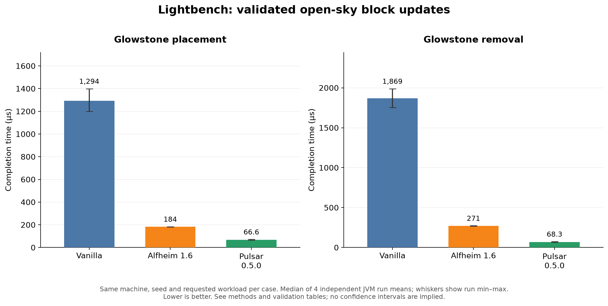
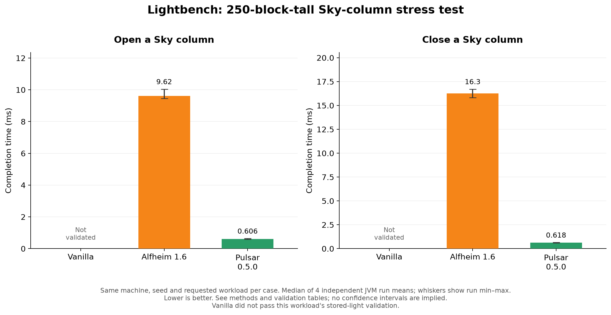
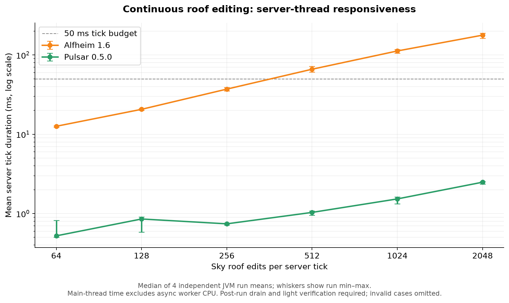
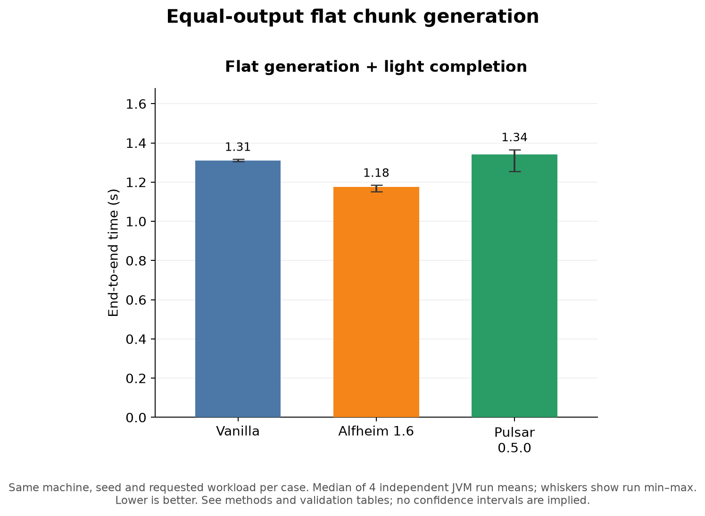
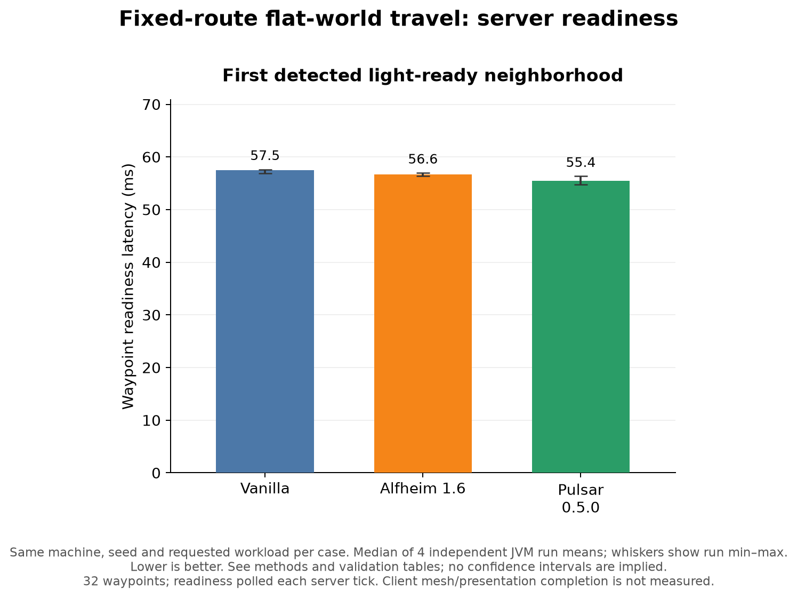

# Pulsar Lighting Engine

This is a mod exclusively for Cleanroom. It requires Java 25 and Cleanroom 0.6.10 or later.

Pulsar is an asynchronous lighting engine built for [Cleanroom](https://github.com/CleanroomMC/Cleanroom).
It reimplements Starlight-style algorithms for Cleanroom and runs lighting calculations on separate threads.

## Requirements

- [Cleanroom 0.6.10-alpha or newer](https://github.com/CleanroomMC/Cleanroom/releases/tag/0.6.10-alpha)

## Features

- Runs server-side light propagation on separate threads.
- Batches large groups of block changes instead of processing lighting separately for every edit.
- Caches light data in each chunk's NBT to avoid unnecessary full relights.
- Keeps Vanilla's block-light and sky-light data synchronized, so removing Pulsar does not corrupt your world.
- Includes various lighting bug fixes and quality-of-life improvements.
- Adds natural lighting to Thaumcraft crystals.
- Fully compatible with rendering mods such as Celeritas, Actinium, and Nothirium.

## Fixed Bugs

- [MC-92](https://bugs.mojang.com/browse/MC-92)
- [MC-1531](https://bugs.mojang.com/browse/MC-1531) — smooth lighting across painting tile boundaries.
- [MC-3329](https://bugs.mojang.com/browse/MC-3329)
- [MC-80966](https://bugs.mojang.com/browse/MC-80966)
- [MC-104532](https://bugs.mojang.com/browse/MC-104532)
- [MC-116690](https://bugs.mojang.com/browse/MC-116690)
- [MC-117067](https://bugs.mojang.com/browse/MC-117067)
- [MC-117094](https://bugs.mojang.com/browse/MC-117094)
- [MC-249343](https://bugs.mojang.com/browse/MC-249343)

### Supported Mods

- [Celeritas](https://git.taumc.org/embeddedt/celeritas): fixes lighting bugs involving stairs and slabs.
- [Fluidlogged API](https://modrinth.com/mod/fluidlogged-api)
- [Depths Update](https://modrinth.com/mod/depths-update): supports dimensions extending below Y=0 or above Y=255.
- [JSON Paintings](https://www.curseforge.com/minecraft/mc-mods/json-paintings): fixes smooth-lighting bugs affecting paintings.

### Incompatible

- [Alfheim](https://www.curseforge.com/minecraft/mc-mods/alfheim-lighting-engine)
- Phosphor for Forge
- Hesperus
- Other Starlight backports or mods that replace or rewrite the lighting engine
- The standard edition of The Aether II, which bundles Phosphor. Use [The Aether II: Phosphor Not Included](https://www.curseforge.com/minecraft/mc-mods/the-aether-ii-phosphor-not-included) instead.

### Unsupported or Untested

- CubicChunks
- OptiFine

## Performance

### Pulsar 0.5.0 Benchmarks

0.5.0

#### Block Placement and Removal

#### Sky Opening and Closing

#### Server Load During Continuous Editing

These values measure main-thread MSPT. Async worker CPU time is not included.

#### Flat Terrain Generation

#### Travel in a Flat World

## Credits

- [Starlight](https://github.com/PaperMC/Starlight) by Spottedleaf: the algorithms on which Pulsar is based.
- [SuperNova](https://github.com/GTNewHorizons/SuperNova) by GTNewHorizons: an RGB lighting engine inspired by Starlight.
- [Alfheim](https://github.com/Red-Studio-Ragnarok/Alfheim) by Red Studio: a reference for directional neighbor brightness, liquid and emissive-block rendering, and light-only chunk packet handling.
- [CleanroomModTemplate](https://github.com/CleanroomMC/CleanroomModTemplate), TokenEnvoy, and CleanroomVersioning by CleanroomMC.

## AI Disclosure

Pulsar uses LLM assistance in the following areas:

- Some code: primarily understanding and implementing algorithms.
- Translation and writing: translating into other languages and generating documentation.

## License

Pulsar is licensed under the [LGPL-3.0](LICENSE.md).
