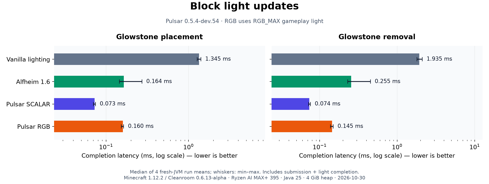
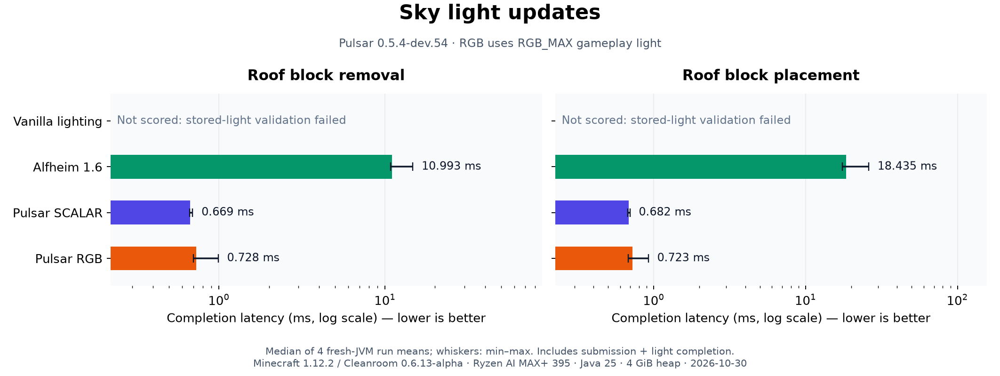

# Pulsar Lighting Engine

## Overview

Pulsar is a lighting engine mod for Cleanroom, based on Starlight and SuperNova.
It replaces Minecraft's vanilla lighting engine with queue-based breadth-first search (BFS) light propagation derived from Starlight.
It offers a non-colored SCALAR lighting mode like Starlight and a full RGB colored lighting mode like SuperNova.

## Features

- RGB colored lighting: Calculates block light and sky light per RGB channel, accounting for light source colors and filtering through blocks such as stained glass.
- SCALAR mode: Uses conventional, non-colored lighting calculations, like Starlight.
- Optional dynamic lighting for light-emitting blocks and lava buckets held in either hand or dropped on the ground, with visual-only or gameplay lighting.
- Burning mobs and players also emit dynamic light using the fire source color, combined with any held light.
- Dynamic light uses a round 7.75-block falloff in open air, preserving source hues while respecting closed faces, opacity and colored-glass absorption. Detours around obstacles add attenuation.
- Asynchronous and parallel processing: Runs server-side light propagation on separate worker threads.
- Batched lighting updates: Groups lighting updates caused by large numbers of block changes.
- Light data caching: Saves calculated light data in chunk NBT to avoid recalculation when chunks are loaded.
- Various additional bug fixes and quality-of-life improvements not listed here.
- Natural lighting for Thaumcraft crystals.

Celeritas's standard terrain renderer follows dynamic light sources every frame with fractional positions and light levels.
While this path is active, players, held items and dropped items share a continuous light sample for model brightness and RGB tint.
Server-side obstruction and colored-glass absorption remain authoritative. Shader packs, other renderers,
or more than 64 nearby dynamic sources use the block-aligned mesh-lighting fallback.

### Fixed Bugs

- [MC-92](https://bugs.mojang.com/browse/MC-92)
- [MC-1531](https://bugs.mojang.com/browse/MC-1531)
- [MC-3329](https://bugs.mojang.com/browse/MC-3329)
- [MC-80966](https://bugs.mojang.com/browse/MC-80966)
- [MC-104532](https://bugs.mojang.com/browse/MC-104532)
- [MC-116690](https://bugs.mojang.com/browse/MC-116690)
- [MC-117067](https://bugs.mojang.com/browse/MC-117067)
- [MC-117094](https://bugs.mojang.com/browse/MC-117094)
- [MC-249343](https://bugs.mojang.com/browse/MC-249343)

### Compatibility

- Fancier Block Particles / Fanciest Block Particles: Applies RGB lighting to their 3D particles while preserving material colors, transparency and full-bright effects.
- JSON Paintings: Applies smooth lighting to paintings added by the mod.
- SpongeForge: Includes compatibility support for asynchronous lighting.
- Fluidlogged API: Accounts for the opacity and light emission of fluids stored inside blocks.
- Future MC: Warm lanterns and campfires, and pale cyan soul lanterns, retaining their original brightness and lit/unlit behavior.
- CBMultipart: Standard microblocks inherit their materials' light source colors. Custom parts retain neutral emission unless handled by a dedicated integration.
- ProjectRed: RGB emission for full-block lamps, multipart fixtures, light buttons, and light microblock materials, preserving their actual brightness and power state.
- Depths Update: Supports extended world height ranges.
- Thaumcraft: Adds smooth lighting to crystals.
- Celeritas: Supports its rendering pipeline.
- Demonica Shader: Tested and confirmed working with Complementary Reimagined.
  - Compatibility with forks such as Actinium, Pintonium, and Impetus is not guaranteed.

### Incompatibilities

Pulsar completely replaces the lighting engine and is incompatible with other lighting engine mods.

- [Alfheim](https://www.curseforge.com/minecraft/mc-mods/alfheim-lighting-engine)
- Phosphor
- Hesperus
- Starlight-1.12
- OptiFine: Use Celeritas instead. Demonica Shader provides shader support, while Celeritas Extra and Celeritas Leaf Culling should cover the additional video options.
- The Aether II: Use [The Aether II: Phosphor Not Included](https://www.curseforge.com/minecraft/mc-mods/the-aether-ii-phosphor-not-included) instead.

## Configuration

- `config/pulsar.cfg`: Selects the lighting mode and configures additional features.
  - `dynamicLights.smoothTerrainLighting`: Client option for per-frame lighting in Celeritas's standard renderer (default: `true`). Disable it to use mesh lighting. It does not change server gameplay light.
  - `dynamicLights.mode`: `OFF` (default), `VISUAL` (rendering only), or `GAMEPLAY` (also affects server light queries, including mob spawning). The server chooses the mode; restart to apply. Enabled modes require compatible Pulsar clients. Supports held and dropped block items and lava buckets in SCALAR and RGB, including occlusion and colored-glass filtering. Stack size does not increase brightness. Other non-block item sources are not yet supported. Disable other dynamic-light mods to avoid duplicate lighting. Dynamic light is transient and never saved in chunk lighting data.
  - `lightingMode`: `SCALAR` (default, conventional, non-colored lighting) or `RGB` (RGB colored lighting).
  - `lightingModeSelected`: `false` by default. On the first client launch, choose SCALAR or RGB once for this instance; the selection sets this to `true`. Changing the active mode requires restarting Minecraft. Modpacks can set this to `true` to skip the prompt; dedicated servers use `lightingMode` directly.
  - `rgbGameplayLight`: `RGB_MAX` (default, uses the brightest RGB component as gameplay brightness; per-channel attenuation affects light checks such as mob spawning) or `VANILLA` (calculates non-colored lighting separately for gameplay light checks).
  - `rgbBlendMode`: Includes an optional `MAXIMUM` mode that combines block and sky light by taking the brightest value per channel. Full daylight stays neutral around colored sources. This controls normal rendering; shader packs handle their own shading.
  - `debug.traceLightUpdates`: Opt-in diagnostics for lighting queues, render requests, and Celeritas rebuilds. Logs a bounded summary every 200 client ticks; caller and position samples cover 1 in 64 requests.
- `config/pulsar-colors.cfg`: Defines light source colors.
- `config/pulsar-filters.cfg`: Defines attenuation for each RGB channel.

### Additional RGB source colors

The additional presets below expand coverage using the block names and state selectors
in [ColoredLux's 1.12.2 Lux Packs](https://github.com/dragon-forge/luxpacks/tree/abb9575047e4d27a1a0b8d864b16dd10d04e3575/1.12.2)
as a reference. They use stable Pulsar hues and the source block's own contextual
brightness. Power, fuel, and other native on/off conditions remain authoritative.
User palette overrides and a mod's own color API retain precedence.

| Mod | Additional source presets |
| --- | --- |
| Quark | Paper, duskbound, elder-sea and blaze lanterns; lit lamps; candles; glowshrooms and glowcelium; crystals and crystal panes |
| Inspirations | Torch levers, powered redstone torch levers and the single-color enlightened bushes |
| Embers / Embers Construct | Lanterns, archaic lights and burning kilns |
| Immersive Engineering | Lantern and balloon variants of the shared device blocks |
| Charm | Smooth glowstone, iron/gold lanterns and variable redstone lamps |
| NetherEx / TAIGA | Blue fire, rime ore/blocks and dilithium ore/blocks, where the installed mod emits light |
| Deep Mob Learning | Infused ingot blocks, simulation/extraction chambers and trial keystones, where the installed mod emits light |
| Pam's HarvestCraft / Coloured Sea Lanterns | Dye-specific candles and sea lanterns |
| Advanced Chimneys | Glowstone and sea-lantern chimneys |
| Exotic Birds / Tinker I/O / Tinkers' Construct | Lit egg sorters/incubators, What a Beautiful Block and the glowing block |
| Vanilla | End gateways use the end-portal hue |

Quark's crystal palette follows its own names: `crystal_blue` is cyan and
`crystal_indigo` is blue. Black candles, crystals and sea lanterns keep neutral
light at their native brightness. Unknown state variants retain their existing
fallback. Absent mods are skipped; the presets do not load optional mod classes.

These presets do not make normally non-emissive redstone/lapis blocks glow.
ColoredLux's randomized flicker, radius formulas and entity lights are separate
features. ColoredLux itself is not required or intended to be installed alongside Pulsar.

## API

Pulsar provides APIs for other mods to define light source colors and light transmission properties.

- `ColoredLightSource` / `PositionalColoredLightSource`: Define RGB emission based on block state or position.
- `ColoredTranslucency` / `PositionalColoredTranslucency`: Define per-channel RGB transmittance.
- `FaceLightOcclusion`: Define light opacity for individual block faces.
- `BlockLightColors` / `BlockLightFilters`: Register light source colors and minimum per-channel absorption for blocks or block states.
- `RegisterLightPropertiesEvent`: Forge event for registering light source colors and filters.
- `PackedLightColor`: Pack and unpack `0xRGB` values with components from 0 to 15, and convert to and from SuperNova's format.
- `LightColors`: Provides basic color constants.
- `ExtendedChunk` / `ExtendedWorld`: Query chunk lighting readiness and pending world lighting updates.

See the [API documentation](https://raw.githubusercontent.com/Sumire-Labs/Pulsar/main/src/main/java/com/sumirelabs/pulsar/api/package-info.java) and [integration example](https://raw.githubusercontent.com/Sumire-Labs/Pulsar/main/src/apiExample/java/example/pulsar/PulsarCompat.java) for details.

Starting with releases containing the Maven publishing workflow, the compile-only
API and its sources are published to Sumire Labs' Artifact Keeper:

```groovy
repositories {
    maven {
        url = 'https://artifact.sumirelabs.com/maven/releases'
        content { includeGroup 'com.sumirelabs' }
    }
}

dependencies {
    // Replace <version> with a published Pulsar release version.
    compileOnly 'com.sumirelabs:pulsar-api:<version>'
}
```

## Benchmarks

Measured on 2026-10-30 with Minecraft 1.12.2 / Cleanroom 0.6.13-alpha, comparing vanilla lighting, Alfheim 1.6, and Pulsar `0.6.0` in SCALAR and RGB (`RGB_MAX`) modes.

The charts measure dedicated-server latency from a block change through completed lighting, including the completion adapter. Each value is the median of four fresh-JVM run means; whiskers show the minimum and maximum. The CPU is a Ryzen AI MAX+ 395, with Java 25 and a fixed 4 GiB heap. Lower is better; axes use a logarithmic scale.





Vanilla passes the open-sky block-light test, but fails the roof fixture's initial stored sky-light validation, so no vanilla sky-update time is scored. RGB computes additional colored-light information. These repeated, individually awaited updates do not measure FPS, chunk generation, or concurrent update throughput.

See the [measured values and run ranges](https://raw.githubusercontent.com/Sumire-Labs/Pulsar/main/assets/benchmarks/2026-10-30/results.md) and [raw measurement results](https://raw.githubusercontent.com/Sumire-Labs/Pulsar/main/assets/benchmarks/2026-10-30/measurement-evidence.zip) for the full comparison.

See [lighting validation notes](https://raw.githubusercontent.com/Sumire-Labs/Pulsar/main/docs/lighting-validation.md) for compatibility probes and the opt-in empty-section experiment.

## Credits

- [Starlight](https://github.com/PaperMC/Starlight): The foundation for the lighting engine's architecture and core algorithms.
- [SuperNova](https://github.com/GTNewHorizons/SuperNova): The source of the ported lighting engine, per-world task management, and packed RGB propagation code.
- [Alfheim](https://github.com/Red-Studio-Ragnarok/Alfheim): A reference for various lighting bug fixes.
- [CleanroomModTemplate](https://github.com/CleanroomMC/CleanroomModTemplate): An excellent mod development template for Cleanroom.
- [CleanroomDevEnv](https://github.com/Sumire-Labs/CleanroomDevEnv): Current development scaffold; its MIT notice is retained in [licenses/CleanroomDevEnv-MIT.txt](licenses/CleanroomDevEnv-MIT.txt).
- CleanroomVersioning: Build plugin for version management.
- TokenEnvoy: Build plugin for embedding metadata at build time.

## LLM Usage

LLMs are used to help write some of Pulsar's code and documentation.

## License

Pulsar is licensed under [LGPL-3.0](https://raw.githubusercontent.com/Sumire-Labs/Pulsar/main/LICENSE.md).
