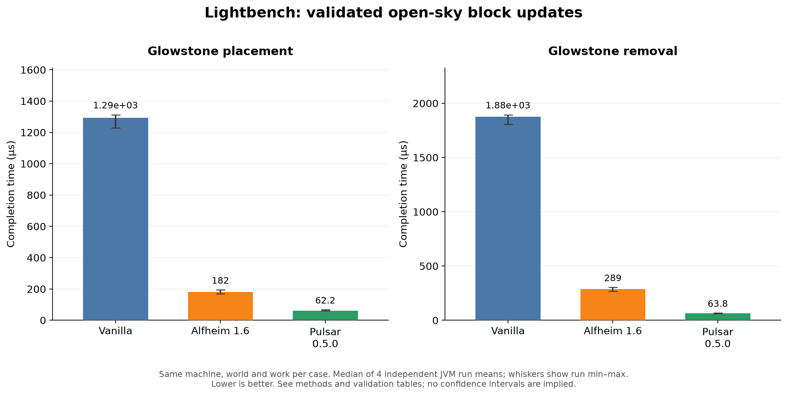
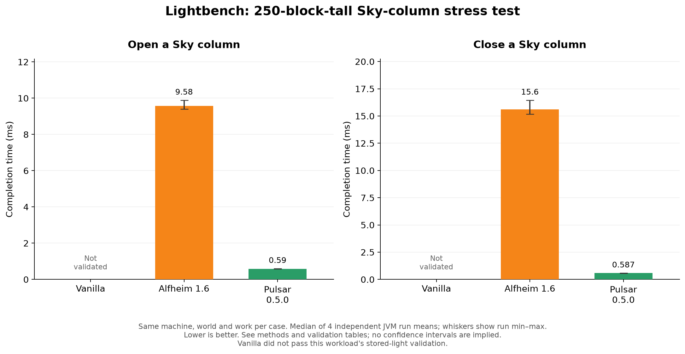
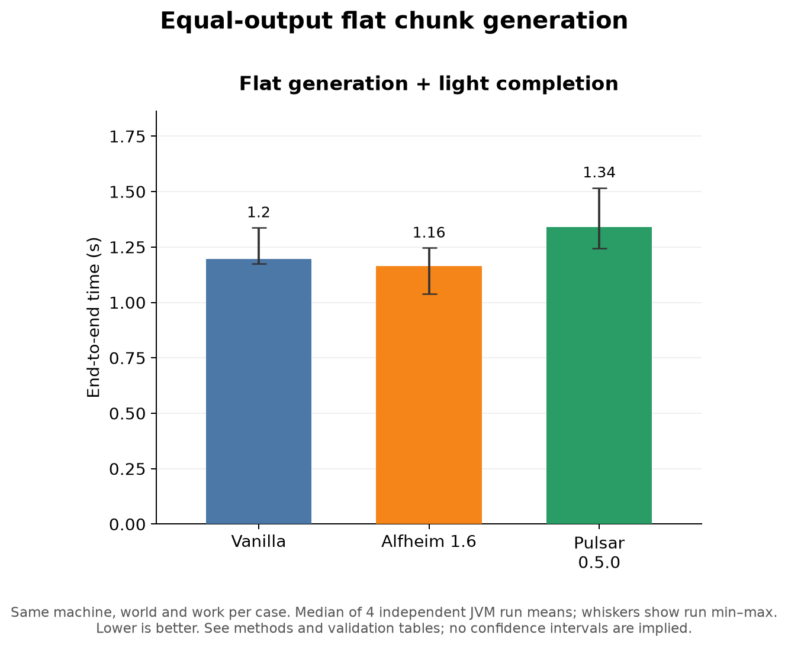
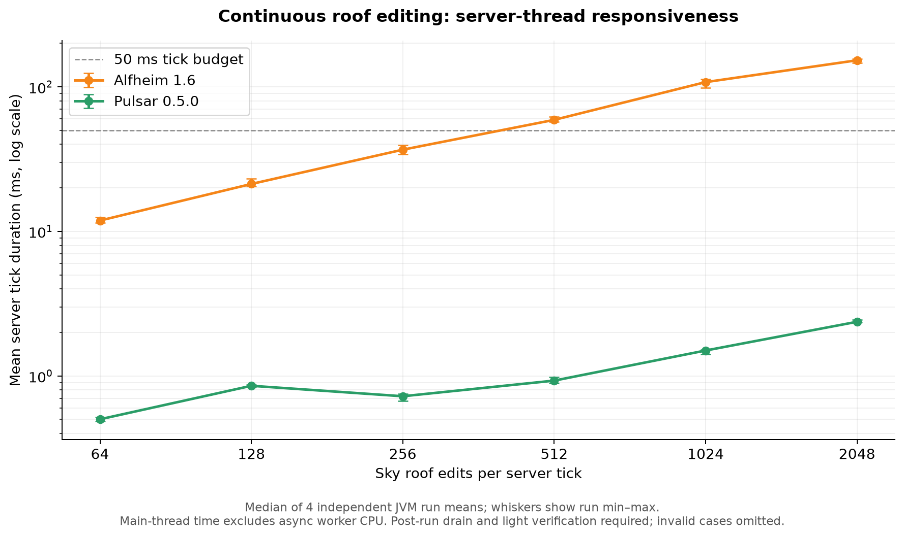
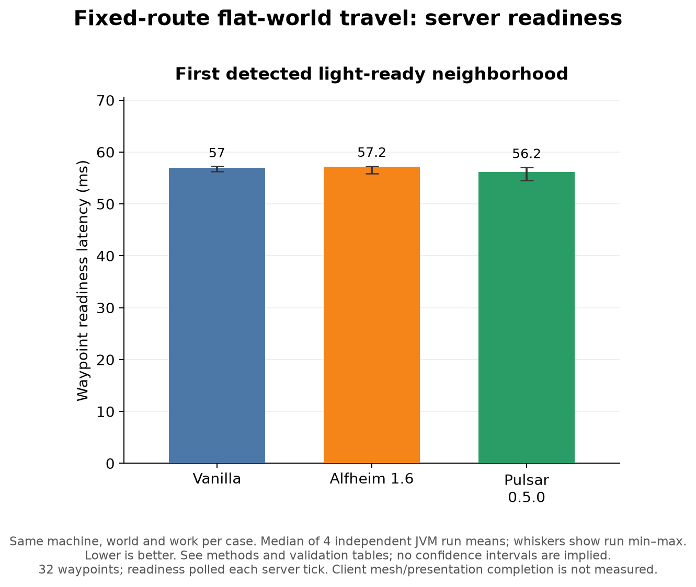
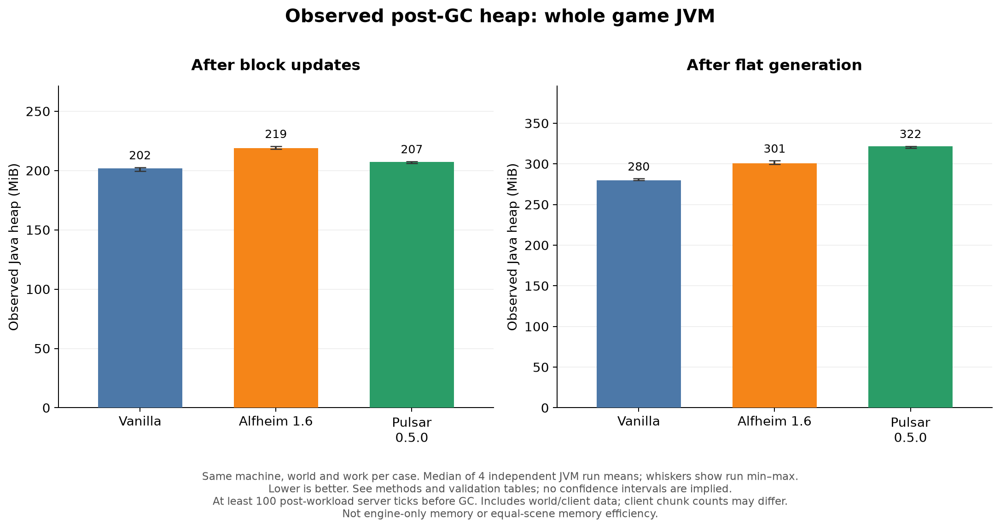
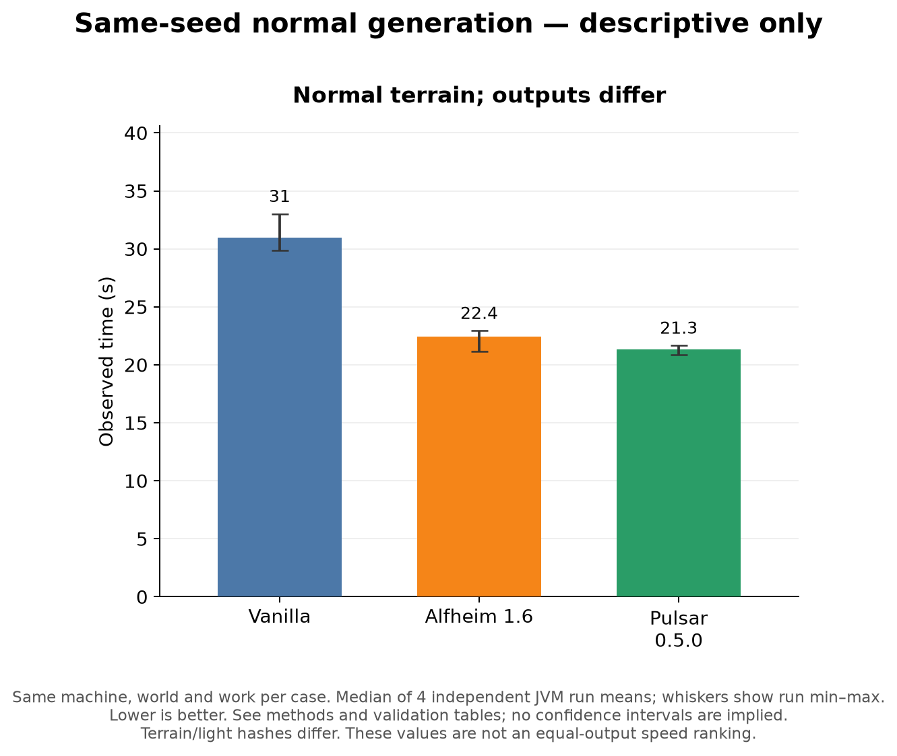
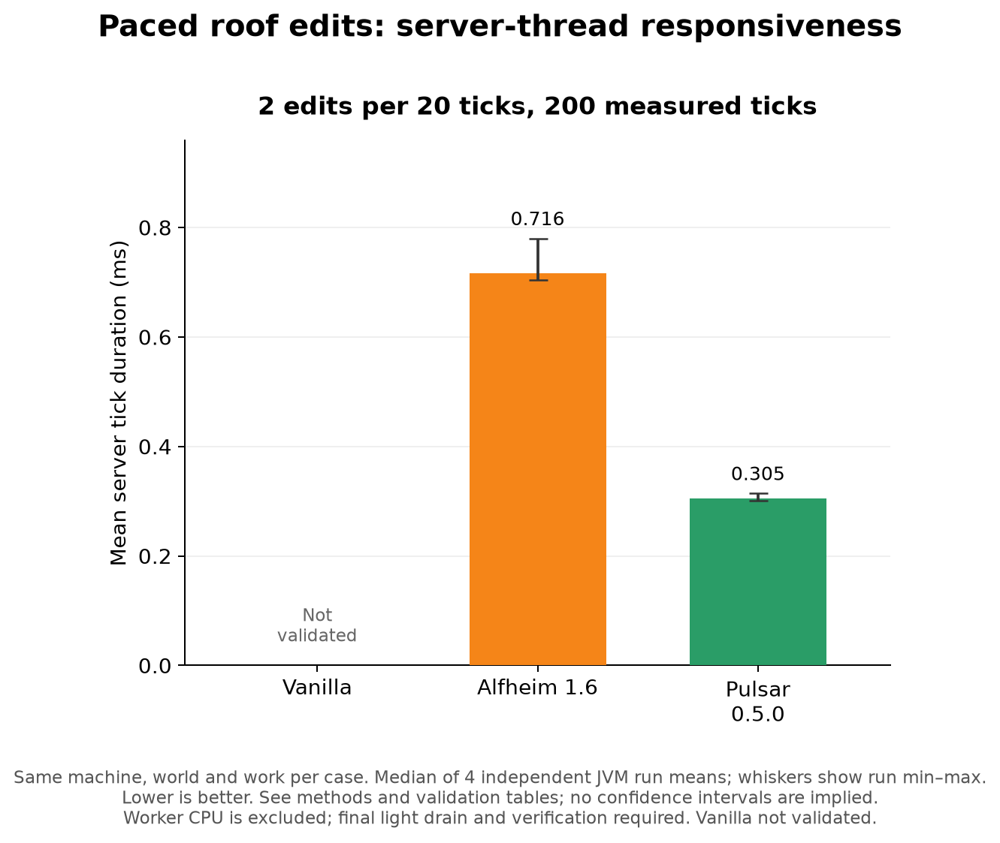
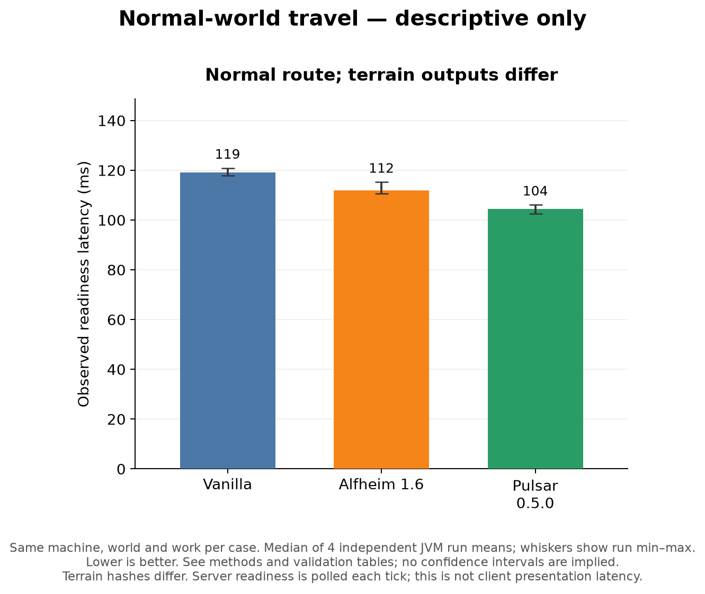

# Pulsar 0.5.0: controlled Lightbench comparison

These are measurements on one machine and one fixed setup, not a promise for every world or modpack. Values are medians of **four independent JVM run means**; figure whiskers show the minimum and maximum run mean, not confidence intervals.

## Validated glowstone updates under open sky

| Engine | Place (µs) | Remove (µs) |
|---|---:|---:|
| Vanilla | 1.29e+03 | 1.88e+03 |
| Alfheim 1.6 | 182 | 289 |
| Pulsar 0.5.0 | 62.2 | 63.8 |

Completion time includes the server block edit and the installed engine's light-completion barrier. The fixture is a uniform low Superflat floor with no roof. Each JVM uses 5,000 warmup pairs and 10,000 measured pairs. Sparse checks run after every edit, and independent complete Sky/Block volume checks run before and after measurement. Update flags are 16; this is not player input, network latency or arbitrary neighbor-event throughput.

## Sky-column stress test

| Engine | Open (ms) | Close (ms) |
|---|---:|---:|
| Vanilla | Not validated | Not validated |
| Alfheim 1.6 | 9.58 | 15.6 |
| Pulsar 0.5.0 | 0.59 | 0.587 |

The 64×64 roof is at Y254 over a floor at Y3. This is a deliberately tall lighting stress test. Vanilla did not satisfy the full stored-light validation protocol and has no comparable score. Normal public chunk maintenance was included for Vanilla; synthetic per-cell repairs were not used to manufacture a passing result.

## Equal-output flat generation

| Engine | Until lit (s) |
|---|---:|
| Vanilla | 1.2 |
| Alfheim 1.6 | 1.16 |
| Pulsar 0.5.0 | 1.34 |

Each measured run submits 5,292 chunks across 12 disjoint regions, including support halos. The 3,468 scored core chunks must have matching terrain and light hashes across qualifying runs. Provisioning, engine completion and explicit finalization are timed; hashing and report writing are outside the timer. This simple flat workload does not represent cave or forest generation.

## Continuous roof editing

| Edits/tick | Vanilla | Alfheim 1.6 | Pulsar 0.5.0 |
|---:|---:|---:|---:|
| 64 | Not validated | 11.9 | 0.501 |
| 128 | Not validated | 21.3 | 0.854 |
| 256 | Not validated | 36.8 | 0.723 |
| 512 | Not validated | 59.1 | 0.928 |
| 1024 | Not validated | 108 | 1.5 |
| 2048 | Not validated | 153 | 2.37 |

Values are main-thread MSPT over 100 requested ticks per rate. A separate warmup precedes scored spikes and the sweep; initial and final stored light are validated. Capped or incorrect cases are excluded. Async worker CPU is not part of main-thread MSPT, and post-run light-drain time is recorded separately. Lower MSPT alone does not prove less total CPU work or faster visual light convergence.

## Travel, frame observations and memory

| Engine | Flat waypoint readiness (ms) |
|---|---:|
| Vanilla | 57 |
| Alfheim 1.6 | 57.2 |
| Pulsar 0.5.0 | 56.2 |

The route has eight warmup and 32 measured waypoints, one chunk apart, with at least 20 ticks of dwell. Readiness covers the loaded 5×5 server neighborhood and is polled each server tick. It is not client mesh or presentation completion. Complete terrain hashes are recorded outside timing.

Frame observations use render-loop callback intervals, **not presented FPS**. Client loaded-chunk counts differ between default engines; these data are therefore not an equal-rendered-scene FPS ranking. The supplemental four-engine dataset retains them for inspection.

| Engine | Observed heap after updates (MiB) |
|---|---:|
| Vanilla | 202 |
| Alfheim 1.6 | 219 |
| Pulsar 0.5.0 | 207 |

Heap snapshots follow at least 100 post-workload server ticks and an explicit GC. They include the entire game, world and client data, rather than engine-only allocations. Client cache sizes can differ. Sampled process working sets are also retained, with two-second polling; neither metric is a general memory-efficiency claim.

## Normal generation: descriptive only

| Engine | Observed time (s) |
|---|---:|
| Vanilla | 31 |
| Alfheim 1.6 | 22.4 |
| Pulsar 0.5.0 | 21.3 |

Normal-terrain/light hashes differ, so these timings are not promoted as equal-output speed ratios. In the 81-chunk pilot, Pulsar's terrain differed by one brown mushroom; the light hashes also differed. That observation is consistent with light-dependent population, but its causal mechanism was not isolated. Formal cohort parity is listed in the raw summary independently of that pilot.

## Reproduction and scope

- Minecraft 1.12.2, Cleanroom 0.6.12-alpha, Adoptium Java 25.0.4.1; G1, fixed 8 GiB heap and compact object headers.
- GMKtec EVO-X2 / Ryzen AI MAX+ 395, 32 logical processors, approximately 95.2 GiB OS-visible RAM, Radeon 8060S.
- 1280×720, render distance 4, VSync off, frame limit 260 (unlimited in 1.12.2), no shaders, Celeritas or OptiFine.
- Common dependencies and configuration are frozen; every variant receives the same default Version2 Pulsar config file. Non-Pulsar variants ignore that file. Pulsar uses automatic `-1` worker sizing, observed as 10 shared workers, and the default 2 ms client budget.
- Four counterbalanced orders: Vanilla→Alfheim→Pulsar→Starlight; Alfheim→Starlight→Vanilla→Pulsar; Pulsar→Vanilla→Starlight→Alfheim; Starlight→Pulsar→Alfheim→Vanilla. Unsupported cases are omitted, not replaced with zero.
- Every JVM receives a fresh world copy. Fresh generation coordinates, completed work amounts and stored-light validation are checked. Within-run timing drift remains possible despite long warmup; run ranges and raw sequences are retained. Drift alone is not proof of JIT compilation.
- The chart label is **Pulsar 0.5.0**, the intended release. The measured source is `75b051d`; its pre-tag artifact reports `0.4.1-dev.24`. Exact engine/runtime JAR hashes are in the manifest. No release tag or publication was created by this benchmark task.
- Vanilla means the builtin lighting implementation under the same Cleanroom/common-mod setup, not a separate unmodified Java8 Mojang installation.

Alfheim is the official [1.6 release](https://github.com/Red-Studio-Ragnarok/Alfheim/releases/tag/1.6). The optional [Starlight-1.12 port](https://github.com/geyesborg/starlight-1.12/tree/0a7d94e7e3fd7333f0e31e896e8a5ff57fb57e4e) was locally built from that commit. Its 33 Java class files are unchanged; only incorrect Pulsar core-plugin manifest entries were removed. It is not an author-supplied release binary. No GPL reference code was copied into Pulsar; Pulsar remains LGPL-3.0.

## Completed validation audit

All 104 formal JVM runs completed and passed their selected workload checks. Each metric cohort has four independent runs. Lightbench’s native strict comparator separately accepted 16 block-update, 12 Sky-update and 16 flat-generation reports; independently recomputed per-run timings match its CSV. Passing a selected workload is not proof that every stored-light cell in an arbitrary world is correct.

| Cohort | Runs | Distinct terrain hashes | Distinct stored-light hashes | Equal-output comparison |
|---|---:|---:|---:|---|
| flatgen | 16 | 1 | 1 | Yes |
| naturalgen | 16 | 7 | 7 | No |
| flattravel | 16 | 1 | Not fully hashed | Yes |
| naturaltravel | 16 | 14 | Not fully hashed | No |

Counts above cover the full four-engine study. Travel checks top Sky/Block light at 1,600 positions; it hashes complete terrain, not complete light volumes. Normal generation and travel have output variation, including between independent runs; the one-mushroom pilot does not explain every formal difference. The cause and extent of those differences remain unisolated. Those timings remain descriptive.

## Paced low-rate roof edits

Edits are paced at 2 edits per 20 ticks, over 200 ticks (`lightbench spikes 2 10`). These are not large simultaneous edit bursts. The p99 values below are medians of each run’s p99 server tick, including non-edit ticks.

| Engine | 2 edits/20 ticks: mean / p99 (ms) |
|---|---:|
| Vanilla | Not validated |
| Alfheim 1.6 | 0.716 / 7.367 |
| Pulsar 0.5.0 | 0.305 / 0.469 |

## Continuous-load completion backlog

| Engine | Post-run drain after 2048 edits/tick (ms) |
|---|---:|
| Vanilla | Not validated |
| Alfheim 1.6 | 138.242 |
| Pulsar 0.5.0 | 11.982 |

This final barrier is outside the measured tick durations. It does not measure the maximum age of queued light work during the sweep.

## Normal travel observations

| Engine | Mean waypoint readiness (ms) |
|---|---:|
| Vanilla | 119.100 |
| Alfheim 1.6 | 111.830 |
| Pulsar 0.5.0 | 104.417 |

## Data and reproduction files

- [Summary CSV](summary.csv), [summary and validation JSON](summary.json), [protocol](protocol.json), [artifact manifest](manifest.json).
- Raw per-edit/per-tick JSON, validation audits, observer data and two-second process samples are retained in [benchmark-data-20261010.zip](benchmark-data-20261010.zip) (publication bundle).
- Lightbench runtime source: `05596de`; offline comparator: `f6ccb91`. Build with JDK25 using `gradlew build`; no profiling instrumentation is attached to measured JVMs.
- [Local companion and analysis source](reproduction/README.md). No worlds, account files or engine binaries are included in this documentation.
