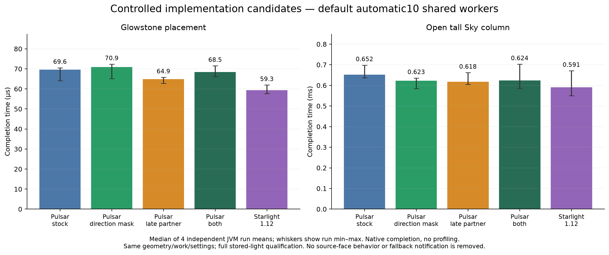

# Pulsar / Starlight-1.12: attribution and implementation study

The main actionable finding was **premature partner-batch capture in Pulsar's shared scheduler**. The ordinary World lighting check can follow the Chunk-level fallback notification for the same position. The fallback exists for direct Chunk mutations and light-relevant changes that vanilla's scalar checks can miss; it must not simply be deleted.

The old shared scheduler claimed both lane snapshots before executing the first lane. Notifications arriving while that lane ran could no longer join the already-claimed partner. In the sampled placement data, **126 of 2,684 edits (4.69%)** ran multiple Block passes. Single-pass edits recorded 1,834 increase entries and one decrease entry; multiple-pass edits recorded **3,668 increase entries and 2,256 decrease entries**. 85.7% of the multiple-pass cases started with Sky. This is observed extra propagation work, not merely time spent copying results.

The observed completion means of these strata were71.59µs and202.08µs. This is an observational association, not a randomized estimate of the cost of one extra pass: scheduling/preemption can also affect which edits split. The controlled implementation experiment below independently tests the batching change.

## Adopted change

Keep the world/5×5 reservation, execute the first lane, **claim the partner only immediately before executing it**, then release the reservation after both. Pending notifications can merge while the first lane runs. Changes arriving after the partner starts still receive a separate batch and future. Initial lighting, shape-aware propagation, contextual values, Fluidlogged integration and fallback notifications remain.

Code commit: **`3347942`**. Only the scheduler and its concurrency tests changed, plus the changelog. Default ConfigVersion2 and automatic `-1` sizing remain; this machine runs10 shared workers. No GPL reference-engine code was copied into Pulsar. No push, release tag or external publication was performed.

## Controlled performance result

Same timing epoch, four fresh JVM/world copies per condition, profiling disabled. Values are medians of the four per-run means; see the raw data for ranges and percentiles.

| Workload | Stock Pulsar | Adopted scheduling | Starlight-1.12 | Change vs stock |
|---|---:|---:|---:|---:|
| Glowstone placement | 69.56µs | **64.86µs** | 59.35µs | **−6.75%** |
| Glowstone removal | 68.15µs | **66.60µs** | 69.69µs | −2.27% |
| Open tall Sky column | 652.47µs | **617.82µs** | 591.45µs | **−5.31%** |
| Close tall Sky column | 648.54µs | **613.41µs** | 649.32µs | **−5.42%** |

Placement and Sky opening still take longer than Starlight in this setup. This change reduces the gap; it does not establish that Pulsar is faster on every workload. Different timing epochs have different absolute values, so these numbers must not be subtracted from the earlier62.2/55.0µs comparison.

The direction-mask candidate retained face behavior and passed exhaustive equivalence checks, but worsened placement/removal here; it was **not adopted**. Combining it with the scheduling change was also less favorable than scheduling alone. A separate worker-count experiment found that one shared worker reduced Sky opening by4.36% but increased placement by6.06%; reducing worker count alone did not solve placement latency. The default was retained.

## Where the time went

Matched sampled engine boundaries locate most of the cross-engine time difference inside propagation, with a smaller coordination/caller residual. Publication/copying was a small component. The implementation experiment identifies a batching contribution to that propagation work. It does not identify every remaining instruction-level or hardware cause.

The new recorder preallocates buffers, captures the same phase/index hashes in both engines, exercises recording during warmup, discards those warmup records, and rejects overlapping writers. For placement, estimated captured-edit perturbation was about1.45µs in Pulsar and0.69µs in Starlight. Sky controls and captured-edit contrasts varied more; use its stage breakdown qualitatively, not as an exact explanation of the old12µs gap. No blanket “fully steady state” claim is made.

Starlight's processed-position counts include adjacent/vertical positions and differ from Pulsar's representation; they are not directly equivalent work units. Packed increase/decrease entry counts are also proxies, not complete instruction or neighbor-visit counts.

## Verification

- **120 qualified formal launches:**48 matched-probe/control runs,32 worker-count runs and40 implementation-candidate runs. The preceding12 cold-recorder runs are retained externally and excluded. Pilots are not scored.
- Prototype179 tests passed. Adopted main build: **178 tests**, zero failures/errors/skips. New tests cover merging before partner execution, arrivals during the first lane under the same reservation/worker, separate futures for changes after execution starts, and stopped partners. Existing independent parallelism and overlap exclusion tests remain.
- Both stock and adopted builds passed paced edits and every continuous rate64–2048 edits/tick with all requested ticks, independent initial/final light checks and no wall cap. These single verification runs are not a new repeated throughput ranking.
- Flat generation matched the stock build's **289-core-chunk terrain/light hash** exactly. Flat travel matched terrain hashes over180 chunks and passed32 waypoints/1,600 top-light checks.
- The actual main-built JAR's scheduler class bytes match the measured scheduling-only candidate. That JAR also passed a normal-terrain generation/readiness audit. This is not an independent full-volume oracle for arbitrary caves/modpacks.
- All benchmark profiles use copied disposable worlds. No normal user worlds are modified. Renderer callbacks are not presented FPS; no FPS or engine-only memory claim is made here.

## Reports and raw data

- [Matched stages and probe controls](matched/README.md):48 runs; [raw JSON](matched/raw-data.zip).
- [Worker-count control](workers/README.md):native n4, exploratory stage supplements n2; [raw JSON](workers/raw-data.zip).
- [Implementation candidates](candidates/README.md):40 runs; [raw JSON and regression/smoke reports](candidates/raw-data.zip).
- [Batch-stratum analysis](batch-analysis.json), [regression parity](regression-summary.json), [main artifact/class/test proof](main-scheduler-proof.json), [variant class provenance](variant-provenance.json).
- [Adopted code patch](implementation/adopted-late-partner.patch), [reproduction notes](REPRODUCTION.md), [bundle manifest](bundle-manifest.json), [file checksums](SHA256SUMS.json).

Original all-engine publication study: [frozen75b051d baseline](../2026-10-10-pulsar-0.5.0/README.md). Those104-run figures precede the scheduling change. The present report supplies a later two-engine/tuning/implementation investigation; it is not a complete rerun of all seven all-engine publication cohorts after the change.
