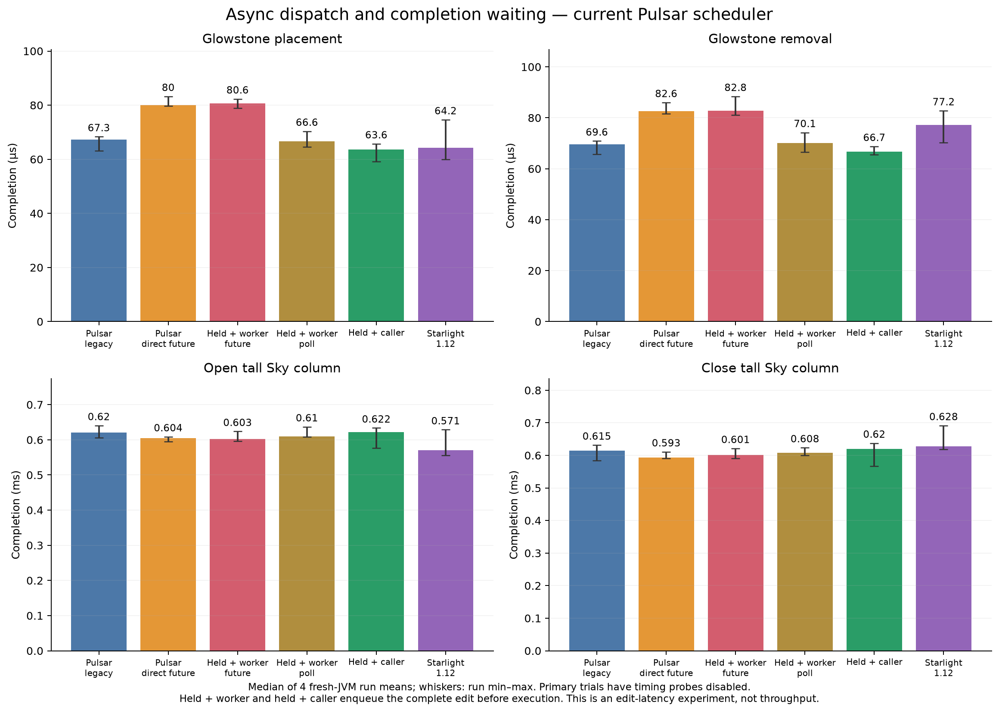
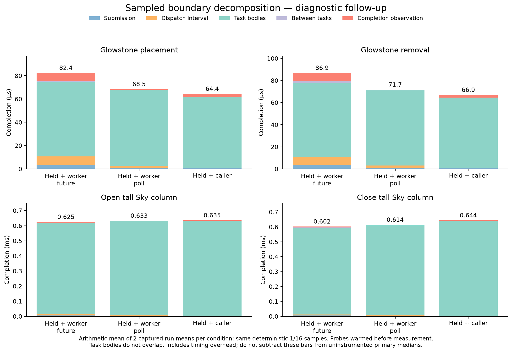

# Async handoff and completion waiting

**Attribution update2026-10-12:** the producer-held controls used a1ms monitor wait for prior reservation cleanup. Although outside the edit clock, it can change inter-edit idle time and task-body timings. Their held-worker/caller attribution is superseded by the corrected controls in [the hot-path investigation](../../2026-10-12-lighting-hotpaths/README.md). Ordinary legacy/direct-future trials did not use that hold and remain valid. Retained timings are historical diagnostic observations, not a clean isolated handoff cost.

## Findings

Measurements completed2026-10-10; final analysis recorded2026-10-12. With producer notifications fully queued, worker/poll versus caller execution differs by about3.04µs in the placement medians (66.65 versus63.60µs). Paired differences range from−0.83 to+11.19µs, so this is not a stable fixed cost. Caller placement is close to the contemporaneous Starlight result64.24µs, but the experiment does not establish that every part of the normal-engine gap is dispatch overhead.

Sky opening does not improve consistently when handoff is removed: worker/poll610.04µs versus caller622.08µs, with paired differences−22.06 to+60.18µs. The normal Pulsar legacy result620.39µs versus Starlight570.55µs cannot be explained by dispatch waiting alone. In the separate sampled worker/poll runs, the Sky dispatch interval plus completion-observation tail averages5.67µs, while task bodies average623.85µs. These sampled numbers include probe effects and must not be subtracted from primary native timings; they show that time is concentrated inside task execution rather than the measured boundary intervals.

All2,838 compared captured phase/index pairs have exactly matching lane task counts, engine counts, positions and increase/decrease entry counts across held worker/future, held worker/poll and held caller conditions. Thus the held comparison does not obtain its timings by doing less recorded propagation work. See [work-equality.json](work-equality.json).

Completion wait policy also matters: direct futures change normal placement from67.35 to80.01µs, while Sky opening changes from620.39 to604.16µs. Replacing polling with blocking futures is not a universal improvement. No production runtime policy is changed as a result of this diagnostic study.

Current Pulsar scheduler3347942, source main87e75ec. Diagnostic builds labeled as the 0.5.0 candidate. This study changes execution placement and completion waiting without changing propagation or face-opacity semantics. No production runtime change is adopted.

48 primary fresh-JVM trials (six conditions, two fixtures, four repetitions), plus12 separate sampled boundary trials. All primary trials have timing hooks disabled. Lightbench60 tests and the scheduler isolation self-test pass. Every measured edit and each initial/final light volume passes the retained checks.

## Native completion latency

Values are microseconds: median of four run means, followed by run min–max. These are isolated edit-completion latencies, not a throughput comparison.

| Condition | Block placement | Block removal | Sky opening | Sky closing |
|---|---:|---:|---:|---:|
| Pulsar normal async + legacy wait | 67.35 (63.19–68.37) | 69.63 (65.78–70.91) | 620.39 (605.67–640.50) | 615.03 (584.74–631.67) |
| Pulsar normal async + direct future | 80.01 (79.73–83.25) | 82.64 (81.61–86.02) | 604.16 (595.40–608.75) | 593.29 (590.99–610.90) |
| Pulsar held + worker + direct future | 80.62 (78.89–82.32) | 82.77 (81.09–88.42) | 602.82 (596.39–623.92) | 600.86 (591.26–621.30) |
| Pulsar held + worker + polling | 66.65 (64.52–70.38) | 70.07 (66.63–74.23) | 610.04 (608.46–637.04) | 607.68 (600.16–623.63) |
| Pulsar held + caller | 63.60 (59.18–65.73) | 66.70 (65.47–68.78) | 622.08 (576.85–633.64) | 620.18 (566.93–637.63) |
| Starlight-1.12 | 64.24 (59.89–74.64) | 77.20 (70.19–82.79) | 570.55 (555.92–628.67) | 628.34 (618.27–691.52) |

## Within-repetition comparisons

Paired differences between fresh-JVM run means within the same repetition. The four repetitions are sequential counterbalanced trials, not simultaneous or randomized per-edit crossovers. Positive means the first condition takes longer.

| Phase | Held worker/poll − held caller | Held worker/future − held worker/poll | Normal async/future − normal async/legacy |
|---|---:|---:|---:|
| Block placement | +2.86 (-0.83…+11.19) | +13.86 (+9.11…+17.42) | +14.40 (+11.41…+16.54) |
| Block removal | +2.84 (-1.07…+8.72) | +13.24 (+6.86…+20.70) | +14.86 (+10.70…+16.54) |
| Sky opening | -13.60 (-22.06…+60.18) | -9.00 (-37.10…+15.46) | -13.47 (-45.10…-2.45) |
| Sky closing | -15.70 (-31.05…+56.70) | -11.08 (-17.44…+14.72) | -15.52 (-33.20…+6.25) |

## Separate sampled boundaries

Arithmetic mean of two captured run means per condition; the same deterministic1/16 indices are sampled. The active recording branch is warmed and discarded before measurement. These include timing overhead and must not be subtracted from the native medians above.

| Phase / held execution | Submission | Dispatch interval | Task bodies | Between tasks | Completion observation | Total |
|---|---:|---:|---:|---:|---:|---:|
| Block placement / worker/future | 3.59 | 7.04 | 64.07 | 0.36 | 7.31 | 82.37 |
| Block placement / worker/poll | 0.77 | 1.96 | 64.96 | 0.27 | 0.51 | 68.45 |
| Block placement / caller | 0.73 | 0.19 | 61.05 | 0.12 | 2.29 | 64.38 |
| Block removal / worker/future | 3.70 | 7.10 | 66.79 | 2.19 | 7.08 | 86.86 |
| Block removal / worker/poll | 0.85 | 2.26 | 67.92 | 0.27 | 0.40 | 71.70 |
| Block removal / caller | 0.65 | 0.18 | 63.62 | 0.15 | 2.35 | 66.95 |
| Sky opening / worker/future | 5.92 | 7.76 | 603.52 | 1.44 | 6.08 | 624.72 |
| Sky opening / worker/poll | 2.72 | 4.39 | 623.85 | 0.37 | 1.27 | 632.61 |
| Sky opening / caller | 1.72 | 0.38 | 629.92 | 0.18 | 2.99 | 635.20 |
| Sky closing / worker/future | 5.16 | 6.91 | 582.74 | 1.45 | 6.10 | 602.36 |
| Sky closing / worker/poll | 2.89 | 4.57 | 603.48 | 0.42 | 2.68 | 614.04 |
| Sky closing / caller | 1.66 | 0.34 | 637.54 | 0.62 | 3.71 | 643.86 |

## Interpretation boundaries

The primary execution-placement comparison is held worker/poll versus held caller. Both queue the complete producer edit before any worker can claim it. It includes releasing the workers and observing completion, OS scheduling and any execution-thread effects on the task body. It is not a measurement of semaphore cost or context-switch cost in isolation.

Holding the producer changes batching and removes normal producer/consumer overlap. Consequently its difference cannot simply be subtracted from the normal Pulsar-versus-Starlight gap. The normal-async legacy control also uses the diagnostic scheduler class; its extra owner check and extracted execute method are shared across all Pulsar conditions. Main runtime itself is unchanged.

Legacy Lightbench waiting calls the existing unload-budget API and then globally polls pending work. The direct-future diagnostic bypasses that budget and waits the existing nearby-chunk futures before the same global check. Changing the wait policy changes measured completion latency; neither result alone is pure propagation time. Aggregate await counters include preparation and warmup as well as measurement.

See [METHOD.md](METHOD.md), [protocol.json](protocol.json), [summary.json](summary.json), [trials.csv](trials.csv) and [sampled.csv](sampled.csv) for exact definitions, last75% sensitivities and per-run data. Six first-harness native trials and three pilots are retained outside this package as superseded exploratory data, and are excluded from every table.

The propagation-loop, direction-dependent opacity and other bookkeeping investigations remain deferred in [FOLLOW-UP.md](../FOLLOW-UP.md). No reference-engine code was copied into production.

Raw JSON and process observations are in [raw-data.zip](raw-data.zip), with internal checksums. Engine binaries, worlds, account data and full game logs are excluded. Exact input hashes and changed class entries are retained in [manifest-final.json](manifest-final.json) and [variant-provenance.json](variant-provenance.json). Diagnostic sources and validation tools are under reproduction/.
