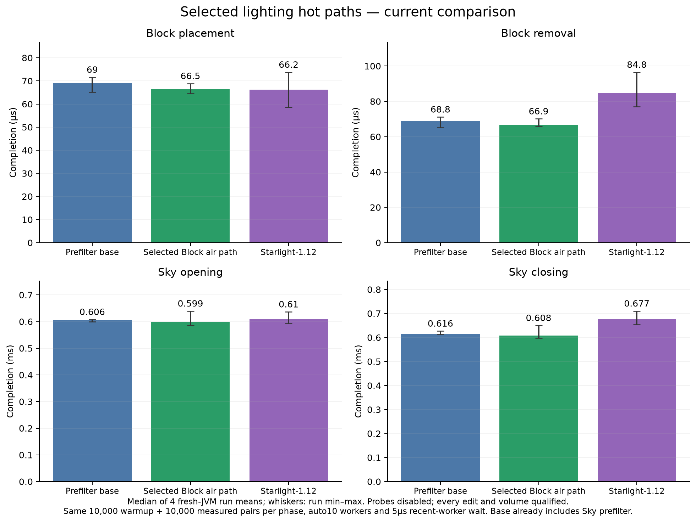

# Lighting hot paths: controlled attribution and selected implementation

The confirmed source-level issue in Sky was a source-face mask test inside every neighbor visit, including ordinary sources whose blocked-face mask is zero. The selected implementation resolves the permitted direction array once, only when the existing sided-source flag requires it. Direction order and mask membership remain identical.

Block propagation also carried verified plain air through generic absorption, emission and sided-flag handling. The selected plain-air branch uses the prior level guard to perform the same write/queue operation directly; other states retain the original generic path. A bounded5µs recent-worker wait catches rapid follow-ups before parking, without holding dispatcher or queue monitors. Parallel worker count, exclusion, late partner claiming and future completion remain.

## Final channel-specific comparison

Four fresh-JVM run means per condition; values below are their medians in microseconds. All use the same command `lightbench updates 10000 10000`, offline launcher mode, default automatic10 shared workers and5µs recent-worker wait. The baseline already includes the selected source-face prefilter; it is not the original release. These data must not be pooled with earlier epochs.

| Phase | Prefilter baseline | Selected Block air path | Starlight-1.12 |
|---|---:|---:|---:|
| Block placement | 69.03 (65.21–71.61) | 66.48 (64.57–68.88) | 66.20 (58.63–73.78) |
| Block removal | 68.77 (65.18–71.17) | 66.87 (65.81–70.14) | 84.75 (76.93–96.54) |
| Sky opening | 606.21 (599.39–608.13) | 598.67 (586.78–639.63) | 610.13 (592.65–636.61) |
| Sky closing | 615.88 (612.19–626.83) | 608.18 (597.04–650.21) | 677.47 (653.90–710.24) |

The selected configuration puts placement in the same range as the comparator and is faster in the Sky/removal medians on this machine. Overlapping ranges are not evidence of universal ordering. Timings include the engine-specific completion adapters and are not CPU-only propagation time or FPS. The independent Source-face experiment changed Sky opening from647.61µs to601.04µs in its own cohort; its comparator was573.48µs. That experiment establishes a code effect, not an instruction-cycle breakdown of every remaining microsecond.

## Correctness and preserved behavior

The actual main JAR passes the full update fixture and all45 shape snapshots. Flat-generation validation covers289 core chunks and exactly matches the original terrain and both light hashes; combined sorted hash is `a6ccfffdca601f779aa9de82084dd435c5036ddb3080429305545cf98229d59e`. Dense regression completes the requested spike and64/128/256/512/1024/2048-edit-per-tick plans with verified roof/light and no wall caps. These are correctness checks, not a repeated throughput ranking. See [main-regressions.json](main-regressions.json).

All native trials passed every per-edit stored-light check and independent initial/final volume checks. Fifteen shape scenarios include air, stone, glass, both slab halves, eight stair orientations and water levels. Each scenario checks lamp-on/off/restored light over61,440 cells and both channels. All45 snapshots match the original implementation, including10 lit sided states. The main build has180 passing tests, including all4096 direction-mask/filter cases and2000 empty-to-work wake/future transitions. Actual main engine class bytes match the measured selected candidate. Further main-artifact regression results are in the retained proof and regression files.

## Rejected hypotheses and measurement limits

The reference normalizes empty block sections to an air/null cache view whereas the old Pulsar cache retained them. A guarded equivalent was tested while retaining all live vanilla light arrays. Runtime inspection found0 non-null empty sections in this fixture; the proposed optimization was not a cause of this benchmark gap and was rejected. Coordinate-width changes, Block direction-loop duplication and Sky plain-air loop duplication were also not selected. Mathematical equivalence or a single fast trial is insufficient for adoption.

Earlier producer-held diagnostic controls used a1ms monitor wait for prior reservation cleanup. Although outside the edit clock, this changes inter-edit idle time and can alter body timings. Their held-worker/caller attribution is superseded. The new control spins only until prior cleanup finishes, without parking; its results are retained in idle-spin.json. Ordinary legacy/future cases did not use that hold and remain valid. Do not label all execution-placement differences as semaphore or context-switch cost, and do not subtract diagnostic boundaries from native means. No hardware cache-miss or retired-instruction counters were measured.

No propagation features or fallback notifications were removed. Contextual/mod/fluid/sided states retain the original path when plain-air eligibility fails. No GPL reference-engine source was copied into production; LGPL is unchanged. Reference snapshot remains the pinned Starlight-1.12 commit0a7d94e7e3fd7333f0e31e896e8a5ff57fb57e4e. Environment matches the earlier studies: Minecraft1.12.2/Cleanroom0.6.12, AdoptiumJava25.0.4.1, fixed8GiB/G1/compact headers, render distance4,1280×720, FPS260(unlimited), vsync off, flat seed1 and disabled random ticking/weather/mobs.

Raw per-edit JSON, input hashes, status and process observations are in raw-data.zip with internal checksums; JARs, worlds, account data and full logs are excluded. Source/validation/protocol inputs are under reproduction/. JFR hotspot summaries identify hot code, not isolated per-line costs; the detailed debug profile enables non-safepoint metadata. Screening is exploratory and not pooled into confirmation. The prior104-run all-engine publication remains a historical baseline, not a rerun of this implementation.

