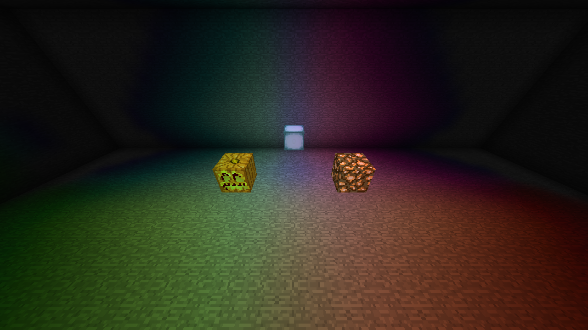

# RGB block-light prototype

This prototype adds server-authoritative RGB block lighting while retaining
Pulsar's scalar engine and LGPL-3.0 license. `SCALAR` remains the default for
this experimental branch. Making RGB the release default is a later step.

**Using the prototype**

Set the following property in the `general` category of `config/pulsar.cfg`
on both the server and client, then restart both:

```properties
S:lightingMode=RGB
```

Use `SCALAR` to select the existing engine. The selection is fixed at startup;
changing the GUI setting requires a restart. Pulsar Config Version 2 remains
managed by Pulsar and should not be edited.

RGB contains three four-bit block-light channels, plus an independent scalar
block-light field for gameplay and compatibility. Sky lighting remains scalar.
Mob spawning and other consumers of Minecraft's light API continue to read
the scalar field.

**Implementation**

| Component | Responsibility |
|---|---|
| `RgbBlockEngine`, `RgbChannelEngine` | Three color propagators and the existing scalar propagator execute within one block-task reservation. |
| `RgbStorage`, `RgbSnapshot`, `RgbChunk` | Chunk-owned working arrays and immutable publication of all RGB channels with canonical block light. |
| `RgbPersistence` | RGB cache version 1, bounded height data and a fingerprint of registered colors. Scalar cache version 13 remains unchanged. |
| `RgbNetwork`, `RgbHello`, `RgbPacket` | Explicit client opt-in, sparse full snapshots, monotonic chunk revisions and color replay after vanilla chunk packets. |
| `RgbClient` and renderer mixins | Main-thread installs and immutable mesh-worker reads; Vanilla/Forge terrain, fluid dispatcher and Celeritas model paths. |
| `RgbMixinSelection` | Excludes RGB chunk fields and renderer hooks entirely in SCALAR mode. |

The color propagator adapts Pulsar's existing scalar BFS in a separate class.
Its directional occlusion, contextual sampling, fluid handling, increase and
decrease rules are retained. The existing SCALAR BFS hot loops are unchanged.
The prototype deliberately pays for three color passes to establish a
correctness baseline before attempting a packed RGB propagator.

The existing shared worker pool and 5x5 chunk reservations cover the entire
RGB/scalar batch. Finished color data is copied together with canonical block
light, and identical publications are suppressed. Range relights additionally
check their publication generation. Unloaded or replaced chunks cannot publish.

Clients receive completed canonical block light along with color. Once RGB is
negotiated, they stop recomputing block light locally; scalar skylight processing
continues. This prevents a local block-light pass from overwriting a completed
server result after dense or partial chunk updates. SCALAR clients retain their
existing synchronization path.

A full vanilla chunk packet can replace its client chunk. RGB therefore follows
ready vanilla chunk packets, including resends, and equal-revision replays can
restore canonical light. Updates use the current vanilla watcher list. Initial
watch deferral, entity tracking and Forge watch-event ordering remain gated by
the existing lighting readiness checks. Messages are bound to their connection
handler and ignored for missing, replaced or incompatible client chunks.

**Registering colors**

Mods can register a static chromaticity for each block state during initialization,
before `FMLLoadCompleteEvent`. For example:

```java
for (IBlockState state : Blocks.TORCH.getBlockState().getValidStates()) {
    BlockLightColors.register(state, 15, 8, 3);
}
```

Import `com.sumirelabs.pulsar.api.BlockLightColors`. Components range from 0 to
15; their peak is normalized to 15 and scaled by the existing contextual scalar
emission. Black is rejected as a light chromaticity. Registering a color does
not make a non-emitting block emit light. Unregistered sources emit white.

Defaults include warm torches/glowstone/lava, red redstone torches and cool sea
lanterns. State-specific colors and changing scalar emission work together.
Dynamic position-dependent RGB hue callbacks and editable color files are not
part of this first prototype.

Changing the color registry invalidates the RGB cache on the next chunk load.
Switching from a scalar-only cache to RGB also triggers a relight. Canonical
scalar data remains available when returning to SCALAR.

**Native validation**

The diagnostic fixture is a sealed 32x10x16 room spanning a chunk boundary.
An independent queue-based reference solver checks every cell, rather than
using a second Pulsar relight as its sole oracle. The fixture temporarily
registers pure red glowstone, green lit pumpkins and blue sea lanterns through
the public API; these overrides are in the diagnostic mod, not Pulsar's jar.

| Scenario | Cells checked per side | Checks |
|---|---:|---|
| Mixed RGB sources | 5,120 | Server RGB/scalar and client RGB/scalar |
| Red source removal | 5,120 | Decrease propagation and stale-color removal |
| Opaque barrier across the boundary | 5,120 | Cross-chunk occlusion and dense edits |
| Green-to-blue source swap with unchanged scalar emission | 5,120 | Hue-only invalidation |
| Full relight and packet replay | 5,120 | Reconstruction and client synchronization |

These cases passed with Vanilla rendering, default Celeritas 2.4.0-dev rendering,
and Celeritas's optional fast model renderer. The latter was enabled explicitly
with `-Dceleritas.useVintageFastBlockRenderer=true`; the diagnostic confirms
that its RGB hook actually executed.

An additional JVM restored the saved RGB cache without a full relight:
the persisted-light flag was valid, and all 5,120 cells matched on both sides.
A SCALAR-only native audit confirmed that `Chunk` did not implement the RGB
extension interface. The unit suite contains 201 passing tests, including
snapshot ownership, independent canonical data, packet bounds, sparse clearing,
protocol handshake and mode selection.



This is an unedited in-game capture. Diagnostic colors are API overrides, and
the diagnostic client uses brightness/gamma 1 for the capture.

Fresh-world mod regressions also passed: all 112 Thaumcraft crystal states,
initial and existing-viewer transmission while lighting is held pending, paired
Forge watch-event ordering, a sealed oak room (zero client/server skylight), and
CQR's native 68,800-cell galleon (zero sky/block differences against a completed
relight and zero server/client mismatches before and after).

The old compatibility fixture reused a world containing its test crystals and
sampled the corner before its chunk was transmitted. Those attempts are not
accepted as race/corner evidence. The accepted replay uses a fresh normal world,
marks manually provided terrain complete, and checks actual client geometry
and idle lighting before sampling.

**Performance and evidence**

| Metric | Previous SCALAR | Prototype SCALAR | Prototype RGB |
|---|---:|---:|---:|
| Block placement (µs) | 95.1 | 86.5 | 350.2 |
| Block removal (µs) | 91.4 | 82.5 | 331.8 |
| Sky opening (ms) | 0.850 | 0.777 | 0.981 |
| Sky closing (ms) | 0.871 | 0.820 | 1.005 |

SCALAR uses four independent JVMs per variant; RGB uses two. Values are medians of JVM run means.
Run-to-run variation was substantial: prototype SCALAR placement run means ranged from 77.1 to 193.6 µs; baseline ranged from 87.0 to 126.7 µs. All runs are retained. These results show no systematic SCALAR slowdown in this cohort, but do not establish a speedup. RGB block updates currently cost approximately four times prototype SCALAR; its four server propagators and snapshot work remain optimization targets.

Measurements use separate Minecraft JVMs, the same non-engine mods, fresh
seed-1 flat worlds, automatic 10-worker sizing and an 8 GiB heap. Lightbench
1.1.0-bench9 uses 2,000 warmup pairs and 1,000 measured pairs per phase, with
light verification after every measured operation and an initial/final volume
check. All measured samples, including long delays, are retained.

These are server-side state-change-to-lighting-completion latencies. They do
not measure FPS, end-to-end network delivery or general modpack performance.
RGB's extra server work is expected at this stage; it is not a speed improvement
over SCALAR. Per-run ranges and sample distributions are retained to expose
run-to-run variation.

Evidence: [raw results, protocol, hashes and replay sources](rgb-block-prototype/).
No Minecraft/CQR assets, third-party mod jars, worlds or launcher account files are included.

**Remaining work before RGB becomes the default**

- Replace repeated channel scans where profiling justifies a packed RGB engine;
  measure allocation, retained engine memory and network/mesh-update cost.
- Improve the rendering path beyond baked vertex-color modulation, including
  RGB-aware lightmaps/shaders, entities, TileEntities and particles. The current
  renderer retains scalar lightmaps/AO and approximates RGB modulation.
- Add RGB skylight, per-channel absorption/color filters and dynamic RGB APIs
  sampled safely on the world thread.
- Expand native coverage to other rendering backends, shader combinations,
  extended-height worlds and mixed client/server configurations.

The source adapts the existing Pulsar implementation under the same license.
`LICENSE.md` is unchanged. The architecture follows the RGB/SCALAR separation
described by [SuperNova](https://github.com/GTNewHorizons/SuperNova).
