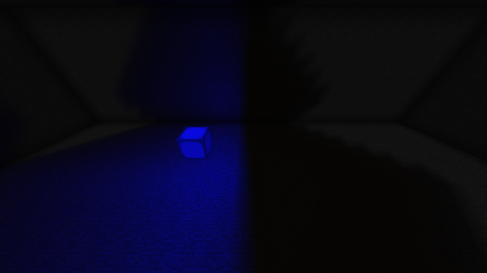

# RGB block-light filters and snapshot reuse

This follow-up to `078df48` adds colored block-light transmission before extending
the engine to colored skylight. SCALAR remains the default and LGPL-3.0 is unchanged.

## Behavior

`BlockLightFilters.register(state, r, g, b)` registers minimum absorption for each
component during mod initialization, before FML load-complete. Each value is 0–15:
zero adds no restriction, while 15 blocks that component. Unlike emission colors,
filter values are not normalized. Air registration is rejected.

Each RGB propagation pass takes the maximum of the filter and the existing
scalar face absorption. Contextual opacity, sided faces and Fluidlogged absorption
are still evaluated through the existing path. A filter cannot make an opaque
block transparent. Unregistered states retain their existing behavior. The API
is static and state-specific; position-dependent filter callbacks are not supported.
Filter keys refer to the stored block state. A fluid occupying a Fluidlogged slot
retains scalar fluid absorption; a separate RGB filter for that fluid slot is not
implemented in this stage.

Vanilla stained glass and panes register all their states. The default absorption
is `round(15 * (1 - dyeComponent))` using Vanilla dye RGB components. This is a
level-based artistic approximation, not physically linear spectral transmission.
Mod registration takes precedence over defaults. Changes of glass color queue
RGB work even when scalar opacity and emission are identical.

The gameplay block-light field remains independent and unchanged. Consequently
RGB can now be weaker than gameplay light. Terrain tinting uses the transmitted
canonical light as its brightness reference instead of renormalizing the brightest
RGB component to full intensity. Vanilla AO and the scalar lightmap are retained;
this is still prototype vertex modulation, with the limitations of that approach.

Canonical-only changes also join the publication set. The initial native filter
test exposed a neighbor whose RGB was fully blocked while its gameplay light
changed: no RGB nibble was modified, so the previous publication trigger missed
that chunk. The RGB composite now observes the scalar publication hook too,
without modifying the SCALAR engine implementation.

Filter registrations participate in the saved RGB profile hash. Existing RGB
caches from the previous prototype are recomputed; scalar cache format 13 and
the RGB packet layout are unchanged.

## Performance implementation

Publication previously cloned every nonzero section in all three RGB planes and
the canonical plane on every touched chunk. It now compares each section against
the preceding immutable snapshot and shares unchanged immutable payloads. Changed
worker bytes are copied before publication, and removed light explicitly becomes
null. No live SWMR bytes escape, including arrays reused in place by later jobs.
Public snapshot constructors and accessors still copy caller-owned data.

For an 18-section chunk with four populated planes, an unchanged publication
avoids copying 147,456 bytes of nibble payload. Reference arrays and the snapshot
object are still allocated, and section comparisons still cost CPU. This does
not reduce packet size or eliminate the three color propagation passes plus
the scalar pass. SCALAR engine loops, chunk layout and renderer selection remain
unchanged.

## Validation

204 JUnit tests pass, with no failures, errors or skips. Added checks cover immutable
section sharing, worker-array reuse, zero clearing, negative section coordinates,
height-layout changes and rendering of RGB weaker than canonical light.

The native Vanilla and Celeritas fast-renderer audits each compare 5,120 cells in
ten scenarios: mixed sources, source removal, an opaque barrier, equal-brightness
source-color replacement, full relighting, red glass, blue-glass replacement,
red panes, filtered full relighting and filter removal. Three RGB components,
published canonical light and stored gameplay light are checked independently
on both server and client. The reference is a bounded flood fill with separate
scalar propagation and independently calculated dye absorption. All comparisons
must match; terrain rendering must produce colored vertices through the tested
backend. Saved-cache reload and old-profile invalidation are separate runs.

The snapshot allocation microprobe uses 18 populated sections in four planes,
2,000 warmup publications and 5,000 measured publications. Its control calls the
new implementation without a preceding snapshot, forcing copies; this isolates
payload reuse rather than comparing whole old and new engines. In the first
native run it allocated 149,768 versus 1,160 bytes per unchanged publication
(99.2% less), taking approximately 9.31 versus 3.56 microseconds per publication.
These are synthetic per-thread allocation and timing measurements, not total
game heap, GC pressure, packet allocation or end-to-end lighting performance.
Changed sections still require copies.

Companion `rgb-filters/validation.json`, `timing.json` and `raw-data.zip` retain
the accepted results and diagnostic sources. Formal update timing is recorded below.

## Native update timing

Baseline is the preceding prototype (`078df48`); the candidate is this change.
Sixteen fresh JVM runs compare both versions in RGB and SCALAR modes, four runs
per version/mode. Each run uses 2,000 warmup pairs and 1,000 measured pairs per
workload. Order is counterbalanced within each mode. Initially there were two
runs per variant; large variation motivated two additional runs per variant.
Every valid run is retained, including the slower first baseline runs and the
later slow candidate runs. All measured edits and initial/final stored-light
volumes passed verification. Timed GC count and time were zero in all runs.

Each cell is the median of four independent run means, followed by the full
range of those means. These numbers measure server edit-to-lighting completion;
packet delivery, frame rendering, total heap and FPS are outside this benchmark.

| Server completion time (µs) | SCALAR before | SCALAR after | RGB before | RGB after |
| --- | ---: | ---: | ---: | ---: |
| Block placement | 119.9 (87.1–189.7) | 89.6 (79.8–205.1) | 318.7 (291.0–423.5) | 311.8 (290.6–525.9) |
| Block removal | 116.5 (83.6–200.4) | 84.7 (77.5–168.3) | 291.1 (258.2–379.0) | 274.0 (261.7–495.5) |
| Sky opening | 809.4 (728.2–954.0) | 755.3 (702.3–1149.7) | 1018.3 (740.2–1310.6) | 744.4 (706.6–1332.9) |
| Sky closing | 847.0 (753.9–977.4) | 779.7 (739.6–1183.2) | 1016.0 (779.6–1329.2) | 781.8 (740.6–1367.0) |

The RGB block-placement median changed by about 2.2% and removal by about 5.9%,
but the ranges overlap heavily. These runs do not establish a general latency
improvement. The scalar skylight algorithm was unchanged; its varying medians
also illustrate why the differences cannot be attributed solely to snapshot
reuse. SCALAR's propagation loops and cache remain byte-for-byte unchanged, RGB
chunk/renderer mixins remain excluded in SCALAR, and this cohort did not establish
a systematic SCALAR slowdown. Both modes have substantial long-tail variation.
The demonstrated performance benefit is the isolated publication allocation
reduction described above. Further CPU improvements should target shared RGB
propagation and repeated block-information work.

Native regression coverage also passed for all 112 Thaumcraft crystal states,
initial-send and existing-watcher races with actual contextual work pending,
a sealed oak room (server/client sky zero), and native CQR ship generation:
68,800 cells matched full relighting and client synchronization. See the
companion validation JSON for exact assertions and raw results.

## Next engine work

Colored skylight still needs direct-sky column handling, absent-section extrusion,
atomic sky publication, persistence and network extensions. These should share
the filter rules above while retaining the independent scalar sky field. The
remaining major block-engine CPU cost is four separate propagation passes;
packing RGB into one queue is a subsequent optimization with its own decrease,
face-occlusion and concurrency validation. Entity/TESR/particle and shader rendering
also remain separate follow-up work.
