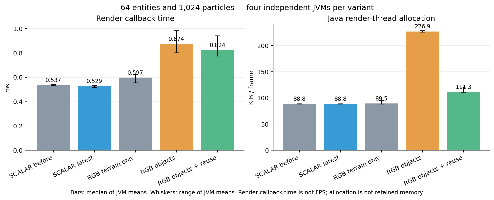

# RGB rendering performance and final native matrix

The rendering paths cover entities, dropped items, regular/Fast TESRs,
particles and held items in the recorded Vanilla/Forge and Celeritas baseline.
RGB remains experimental and opt-in. SCALAR remains the default and LGPL-3.0
is unchanged. This is not a release-readiness claim for every renderer or
Cleanroom version.

## Sampler reuse

JFR allocation samples identified repeated boxed chunk keys in
`RgbClient.tintAbgr`. Previously, the sampler looked up the same view for each
of eight adjacent cells. It now visits both Y cells together and reuses the
last column's view within that call. Interior samples need one map lookup;
chunk-corner samples need at most four. The eight cells, maximum reductions,
canonical light and sky modulation remain unchanged. No view is retained
between calls, so this introduces no persistent invalidation cache.

Five tests cover interior color/alpha, negative-coordinate chunk corners,
vertical section boundaries, missing neighbors/sky-only views, and scalar
skylight fallback. Final native GPU and vertex probes confirm material colors,
alpha, full-bright behavior and state restoration in both renderers.

## Client measurements

Each row uses four fresh JVMs, 600 warm-up frames and 1,200 measured frames,
with 64 entities and 1,024 particles. Order is counterbalanced. Values are
medians of the four JVM means; graph whiskers show their range.

| Variant | Render callback (ms) | Render-thread allocation (KiB/frame) |
|---|---:|---:|
| SCALAR before object rendering (`0248f97`) | 0.537 | 88.8 |
| SCALAR latest | 0.529 | 88.8 |
| RGB terrain only (`0248f97`) | 0.597 | 89.5 |
| RGB object rendering (`e8c3f26`) | 0.874 | 226.9 |
| RGB object rendering with sampler reuse | 0.824 | 111.3 |

For the same RGB object-rendering work, allocation falls **50.1%** using paired
geometric ratios (95% t interval: -53.5% to -46.4%). Callback time changes
**-4.9%**, with an interval of **-13.1% to +4.1%**. This establishes an
allocation reduction; it does not establish a callback-time improvement.
The ratio statistic differs from a ratio of the displayed medians.

RGB objects still add real work: latest callback time is **41.3% higher** than
the terrain-only RGB reference in this workload (interval +29.9% to +53.6%).
That reference leaves objects uncolored. The optimization does not make added
object rendering free; its remaining CPU cost warrants further profiling.

SCALAR callback time changes -1.9% here and allocation +0.015% (allocation
interval -0.15% to +0.18%). No SCALAR rendering regression was observed. The
small time difference is not attributed to the RGB sampler, which SCALAR does
not use.

RenderTick START-to-END is a CPU-side callback interval, not FPS or whole-frame
presentation time. Java allocation is not retained heap or GPU memory. These
measurements do not describe every scene, renderer or machine.

## Common server-path check

The [initial-send retry repair](initial-chunk-send-retry.md) also affects
SCALAR worlds. Lightbench compares `e8c3f26` against the latest artifact using
four fresh JVMs per variant, 2,000 warm-up pairs and 1,000 measured pairs per
phase. Every sample passes the lighting verification. All 21 engine classes
remain byte-identical; common manager, send and tick code changes are tested.

| Phase | Before (µs) | Latest (µs) | Paired change | 95% t interval |
|---|---:|---:|---:|---:|
| Block placement | 91.79 | 92.65 | -4.1% | -16.3% to +9.8% |
| Block removal | 87.29 | 86.20 | -4.7% | -15.5% to +7.5% |
| Sky opening | 754.74 | 751.63 | -0.6% | -8.9% to +8.6% |
| Sky closing | 789.64 | 789.59 | -0.1% | -6.8% to +7.0% |

Times are medians of JVM means; paired changes use geometric ratios, explaining
why their signs can differ from ratios of the medians. These intervals span
zero. No consistent server latency regression or improvement is established,
and this experiment cannot rule out smaller effects.

## Native acceptance and boundaries

The latest artifact passes ten final native cases: object rendering in both
renderers, dense/range skylight in both, cache reload and migration, RGB block
lighting in both, SCALAR isolation, and Thaumcraft/CQR/Fluidlogged regression.
Object cases cover actual dropped-item vertices, chest/sign TESRs, negative
signed lightmap coordinates, daylight cyan transmission, display lists,
nesting, exceptions and texture-unit restoration.

Four additional two-JVM cases cover RGB/RGB, SCALAR/SCALAR and both mixed
combinations through dimension travel and disconnect/rejoin. They disable
diagnostic initial-send assistance. A private transport workaround for a
legacy LOGIN/PLAY encoding defect remains necessary in this runtime; it is
disclosed in the initial-send report and is not shipped in Pulsar.

The build and all **232 JUnit tests** pass. The platform is Cleanroom
0.6.12-alpha, Java 25, Ryzen AI MAX+ 395/Radeon 8060S and optional Celeritas
2.4.0-dev. Cleanroom 0.7, custom GLSL and renderers taking over the reserved
fixed-function unit remain unverified. RGB modulates the existing lightmap/AO;
it does not replace it with shader RGB lightmaps.

See [raw evidence and replay protocol](rgb-render-validation/README.md) and
[the user/API guide](../rgb-lighting.md). All timing samples, including GC,
are retained. Four-pair t intervals use independent JVM means, rather than
treating frames or light edits as independent experiments.
