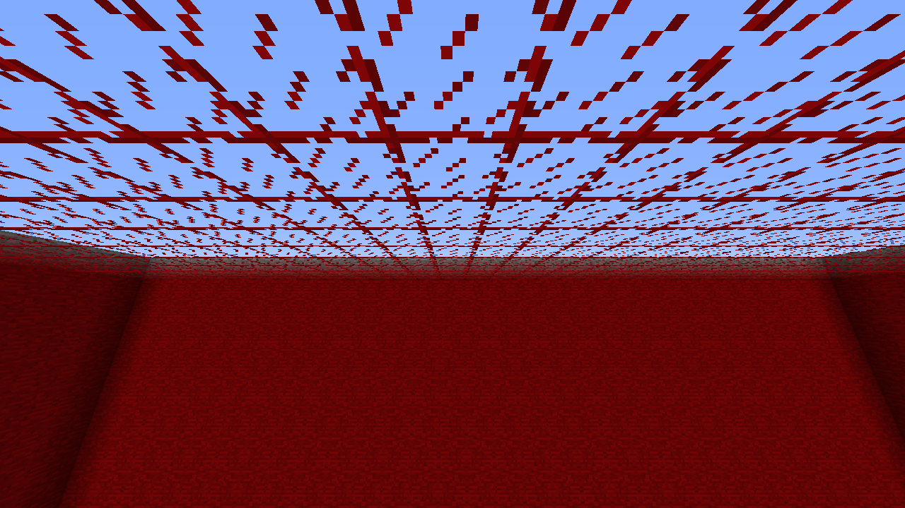

# RGB skylight prototype

This continues the RGB block-light and filter prototypes from `45039e4` on
`feat/rgb-engine`. RGB mode now computes colored skylight as well as colored
block light. SCALAR remains the default, with its original chunk layout,
propagation loops and renderer paths. LGPL-3.0 is unchanged.

## Sky propagation

The RGB sky lane has three component engines derived from Pulsar's own scalar
sky engine and column processor. All components run under the existing lighting
reservation, followed by the independent scalar sky engine. A single immutable
snapshot publishes the three completed components and their canonical gameplay
sky field. Sky and block snapshots have independent revisions.

Direct sky starts white at level 15. A component remains direct sky through
blocks that pass the existing direct-sky rules and add no filter absorption.
A positive filter stops direct column extrusion for that component; the normal
flood fill handles its attenuation from the last direct source. Consequently a
zero-absorption red filter can preserve red 15 down a shaft while blocking green
and blue. Vanilla dye-based filters generally weaken every component and their
weakened light then decays with distance, as other non-direct skylight does.
This is an explicit level-based prototype model, not spectral simulation.

The static `BlockLightFilters` API applies to both sky and block light. Existing
contextual opacity, directional faces and scalar Fluidlogged absorption remain
part of the light-information path. Independent RGB filtering of a fluid slot,
dynamic filter callbacks and colored sky-source providers are outside this stage.

Normal sky brightness remains a separate scalar field for gameplay and Vanilla
packets. Filter color changes still queue sky work even when ordinary opacity
does not change. Canonical-only changes also trigger RGB sky publication. Range
relighting includes RGB sky and retains generation checks at publication.

## Missing sections, persistence and synchronization

Missing sky sections are resolved using Pulsar's existing sky extrusion rules
before publishing or sending a snapshot; they are not interpreted as black.
Saved resolved zero sections restore as initialized zero nibbles, which avoids
turning a saved shadow into an unknown section that extrudes white sky.

RGB cache format **2** requires sky data in sky-enabled dimensions. A format-1
RGB cache is relit on load. The scalar cache stays at **13**, and the managed
configuration version stays at **2**; these are separate version numbers.

RGB protocol **2** adds independent sky/block lanes and full-plane mask bits.
The handshake requires protocol 2 before color packets are sent. Older and
SCALAR peers continue through the scalar path. Both current client and server
must enable RGB and restart for colored lighting.

Server snapshots are installed on the client thread with connection, dimension,
chunk identity, height and per-lane revision checks. Once a server sky snapshot
is active, client sky tasks complete their coordination without overwriting
the server's canonical sky by running local propagation. Full chunk resends
still replay color snapshots after the Vanilla packet. The render view combines
immutable block and sky snapshots, and scales sky contribution with the existing
day/night value. Vanilla AO and the scalar lightmap remain in use; this is still
terrain vertex modulation. Entities, TESRs, particles and shader integration
remain follow-up work.

## Allocation and packet work

Saturated immutable planes share a private full-light constant. Public accessors
still return copies, and mutable worker or Vanilla arrays never alias that
constant. Unchanged nonuniform sections reuse the preceding immutable payload.
Absent-section resolution walks downward once, retaining the nearest non-null
section above. Its bottom-row extrusion is reused across consecutive holes.
This replaces 256 repeated upper-section searches per absent section. Full sky
uses the constant rather than allocating a 2 KiB temporary plane. A randomized
test checks 2,359,296 component/canonical values against the existing scalar
extrusion reader, including Java-null, null-state, zero, full and arbitrary data.

Encoding reads immutable snapshot planes directly, avoiding temporary section
clones. A full plane is represented by mask bits with no 2 KiB payload. An
18-section all-white sky snapshot is **46 bytes** of packet payload instead of
147,502 bytes for four raw planes, excluding Forge/transport overhead. Arbitrary
nonuniform planes still carry their nibble data. Client canonical installation
copies directly into existing Vanilla arrays; full light in absent physical
sections uses SWMR full-state storage without allocating a new 2 KiB array.

These changes reduce snapshot and transmission overhead. CPU propagation is
still three color passes plus a scalar pass for each lighting type. RGB sky adds
work relative to the preceding block-only prototype; the native comparison below
measures that cost separately from SCALAR.

## Native validation

The disposable integrated-game audit checks 24,576 cells per case against an
independent four-field reference. It validates RGB sky, published canonical sky,
stored sky and unchanged block light on both server and client, and checks that
actual client roof geometry matches the server. Colored cases must produce
colored terrain vertices. The fourteen scenarios are:

1. Sealed room.
2. Red stained-glass roof.
3. Blue stained-glass roof; the final-jar audit additionally splits red and blue
   at the chunk boundary to verify cross-chunk color mixing.
4. A registered zero-red/full-green-blue-absorption glass filter.
5. Sky closing.
6. Sky opening.
7. A wall at the chunk boundary.
8. Full relighting.
9. Wall removal.
10. Restoring a blue roof.
11. Floating red-filter canopy.
12. Closing that canopy.
13. Removing the canopy.
14. Restoring the red-filter canopy.

The floating cases sample 96 vertical layers through a chunk with fourteen
absent physical sections. The range variant additionally holds the existing
world lighting gate while queuing two range targets and superseding one with a
new ordinary relight, then verifies final publication against the reference.
The helper's pure-red glass registration is diagnostic only; production default
glass remains unchanged and stained glass uses Vanilla dye colors.

New-cache reload and migration are separate runs. The migration fixture preserves
the same color profile and canonical/block cache data, changes the RGB version
to 1 and removes sky cache fields. It exercises schema rejection without a
simultaneous palette change. Player preloading can regenerate distant chunks
before their later diagnostic query; the main chunk's rejected-cache flag is
checked explicitly. The fixture is not a reporter-supplied world.

Results, exact artifact/source hashes and reproducible diagnostics are recorded
in the companion `rgb-sky-prototype` directory. The comparison cohorts and limitations are recorded below.

## Native timing results

The first cohort contains sixteen fresh JVMs: four per version/mode, comparing
`45039e4` against the initial sky implementation. Every workload uses 2,000
warmup pairs and 1,000 measured pairs. Order is counterbalanced, all valid runs
are retained, and all measured edits plus initial/final stored-light volumes
passed verification. Cells below show the median of independent run means,
followed by their full range. This is edit-to-server-lighting completion, including
worker completion; it measures neither FPS nor packet delivery.

| Completion time (µs) | SCALAR before | SCALAR with sky prototype | RGB block-only before | Initial RGB sky prototype |
| --- | ---: | ---: | ---: | ---: |
| Block placement | 85.9 (80.7–94.1) | 81.6 (75.9–90.4) | 319.3 (299.1–348.6) | 292.8 (287.1–300.8) |
| Block removal | 82.9 (78.1–87.3) | 78.4 (75.6–82.2) | 284.9 (266.3–330.0) | 275.3 (274.0–286.9) |
| Sky opening | 710.7 (672.7–736.6) | 717.8 (676.7–748.8) | 709.3 (697.4–811.7) | 3383.2 (3188.3–3480.5) |
| Sky closing | 747.5 (714.7–776.4) | 762.0 (716.9–776.6) | 749.8 (745.2–863.5) | 3589.5 (3455.9–3689.7) |

SCALAR's ranges overlap with the baseline and show no clear systematic slowdown.
The initial RGB sky workload is about 4.8 times the preceding block-only RGB
prototype's scalar-sky workload. The three additional component traversals are
a substantial CPU cost; snapshot/network optimizations do not remove those passes.

A second, separate cohort compares the first sky implementation with the final
missing-section resolver: eight fresh JVMs, four per version, counterbalanced
in prototype/optimized/optimized/prototype order twice. Inputs and workloads
are unchanged. This isolates the publication implementation change while both
variants compute RGB sky.

| RGB completion time (µs) | Sky prototype control | Final optimized sky |
| --- | ---: | ---: |
| Block placement | 287.3 (276.2–340.2) | 296.0 (288.8–329.3) |
| Block removal | 273.7 (262.4–330.9) | 281.6 (267.2–309.3) |
| Sky opening | 3274.6 (3264.4–3663.6) | 3100.9 (3029.6–3222.4) |
| Sky closing | 3474.5 (3447.5–3887.3) | 3305.4 (3182.0–3405.6) |

The final resolver reduced the sky-opening median by about 5.3% and sky-closing
median by about 4.9% in that paired cohort. Block timings moved by approximately
3% with overlapping ranges, which does not establish a block-light performance
change. The final sky-opening value is about 3.10 ms; compared descriptively with
the earlier block-only RGB cohort's 0.709 ms, substantial RGB sky overhead remains.
These different cohorts should not be used to advertise a precise overall
speedup or FPS claim.

Reported GC deltas are retained: two initial-cohort sky-prototype runs each
reported one 4 ms collection; each final optimized run reported one collection
of 4–5 ms. Other runs reported zero. No run or sample was removed for GC or
long-tail timing. Full per-edit samples and all run means are in the evidence.

The final jar differs from the initial sky prototype only in `RgbStorage.class`
and the English `PulsarConfig.class` description. Its propagation, dispatcher,
packet, renderer and scalar classes are otherwise byte-identical. Final native
Vanilla/Celeritas, range supersession, cache reload/migration, block-light,
SCALAR isolation, Thaumcraft and CQR checks all use the optimized jar. The
209 JUnit tests pass without failures, errors or skips, including the randomized
extrusion equivalence check.

## Remaining performance work

The main CPU optimization candidate is sharing RGB propagation and repeated
block-information reads instead of running three complete component traversals.
A proven white-sky shortcut for regions unaffected by filters could also avoid
color work, but needs explicit invalidation when filters are added or removed
and correct treatment of neighboring chunks and direct sky. SCALAR should keep
its independent path while those optimizations are developed.
