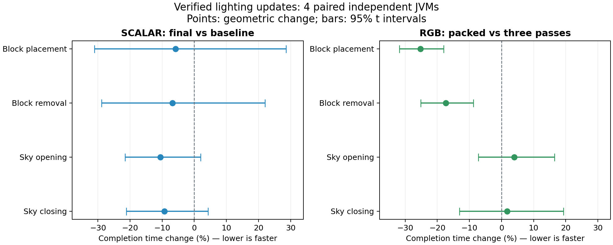

# RGB completion validation

This directory records the SuperNova-style Minecraft 1.12.2 adaptation on
`feat/rgb-engine`. It contains 260 passing unit tests, 43 accepted native
single-JVM runs across implementation stages, and four actual two-JVM TCP
mode combinations. Every run retains its own artifact and diagnostic hashes;
these are not all executions of the same intermediate JAR.

The supported rendering matrix is Vanilla/Forge and Celeritas 2.4.0-dev on
Cleanroom 0.6.12-alpha and 0.7.7-alpha, Java 25, Ryzen AI MAX 395/Radeon 8060S.
Fluidlogged, Thaumcraft crystals and CQR checks use the recorded 0.6 baseline;
the 0.7 renderer/API/remote checks use the minimal recorded mod set.

## Functional coverage

- Static and positional emission/transmittance, weak and vanilla-zero emitters,
  source/filter overlap, color-only updates without block notifications, and
  user override precedence. Positional callbacks are checked on the world thread;
  explicit SCALAR runs assert zero static and positional RGB callbacks.
- Independent full-volume RGB reference comparisons, per-component direct sky,
  dense changes, absent sections, range relights, generation exclusion and halo
  preservation. Final Sky range stages compare 24,576 cells each.
- Fluidlogged lava with a deliberately conflicting containing-block color:
  insertion, full relight and removal, on server and client, under both policies.
- All five blends with both renderers; registered normal/Fast TESR factories,
  entities, particles, held items, alpha/full-bright/exception/GL state checks.
  Runtime blend changes also issue terrain rebuild requests.
- Fresh config, mismatched-version regeneration and retained explicit SCALAR.
  Current-profile cache restoration is accepted; changing the profile rejects
  the cache and produces correct relighting.
- RGB/RGB, RGB/SCALAR, SCALAR/RGB and SCALAR/SCALAR TCP sessions, dimension travel
  and rejoining. RGB_MAX canonical values 0/15/0/0 reach monochrome clients.

The private packet mixin only observes encoding. It never changes the protocol
state, and no forced initial-send diagnostic is enabled in these TCP passes.
The legacy Forge LOGIN/PLAY race remains visible in failed-attempt logs:
`NetworkDispatcher` can switch to PLAY before queued `SPacketLoginSuccess`
encoding. This occurs with a SCALAR server too. Ordinary login retries are
counted: the final RGB/RGB run uses two connections (initial plus rejoin), while
SCALAR/RGB uses four. Rapid intentional disconnects also retain queued vanilla
packet task errors; these results do not assert error-free transport logs. No
transport workaround is shipped in Pulsar.

## Performance protocol and results

The initial 28 independent JVM runs revealed an unacceptable packed candidate:
RGB completion estimates were slower, and SCALAR estimates were 6–8% slower
with wide confidence intervals. Those raw runs and analyses are retained.
A separate block-only JFR diagnosis found redundant destination reads/index
calculations and field-based queue work in the packed BFS. The revision keeps
queues local, writes through resolved cells, converts two nibbles per byte and
moves packed-only bind/publication work out of common SCALAR method bodies.
SCALAR worker dispatch also bypasses the larger RGB policy branch.

After native revalidation, 16 new server JVMs compare four counterbalanced
pairs per condition, with 10,000 warmup pairs and 3,000 measured pairs per
workload. Each sample must pass the light check. RGB uses the same candidate
JAR/policy/blend on both sides, switching only `-Dpulsar.rgb.packed=false` for
the diagnostic three-pass reference. SCALAR compares the clean deferred-send
fix baseline against the final candidate. No other game, build, archive or
profile runs concurrently with formal timing.

JVM means are the independent observations. Changes below are paired geometric
changes with two-sided 95% t intervals (3 degrees of freedom); negative is
shorter completion time. The times include waiting for asynchronous completion.

| Workload | RGB packed vs three-pass | 95% interval | SCALAR final vs baseline | 95% interval |
|---|---:|---:|---:|---:|
| Block placement | -25.2% | [-31.8, -18.0]% | -5.9% | [-31.1, +28.6]% |
| Block removal | -17.4% | [-25.2, -8.8]% | -6.8% | [-28.8, +22.1]% |
| Sky opening | +3.9% | [-7.2, +16.5]% | -10.6% | [-21.6, +2.0]% |
| Sky closing | +1.8% | [-13.1, +19.3]% | -9.3% | [-21.2, +4.3]% |

Packed block placement/removal improve in this workload. Sky does not establish
an improvement or regression. No SCALAR slowdown is established, but the block
intervals remain wide: this is not a tight equivalence proof or a claim of a
SCALAR speedup. Both the initial unfavorable experiment and the final retest
remain available rather than selecting only favorable individual runs.

The original 12 client JVM runs remain attributed to `parity-defaults.jar`.
The final worker/cache revision leaves 72 renderer/RGB/proxy class bytecodes
identical (`renderer-bytecode-proof.json`); its changes target lighting work,
not the measured static-scene RenderTick interval. SCALAR callback time changes
by -6.4% (95% [-21.2,+11.2]) and render-thread allocation by -0.28%
([-1.03,+0.47]). These establish neither a callback speedup nor an allocation
regression. Four RGB client runs are descriptive; RGB and SCALAR perform
different rendering work. Callback timing is not whole-frame FPS, allocation
is not retained heap, and no GPU-memory or engine-memory reduction is claimed.

## Files

- `validation.json`: unit and native result summaries with original stage hashes.
- `native-evidence.zip`: native reports/logs, private diagnostic source and protocols.
- `performance.json`: final server comparison and attributed client records.
- `initial-performance.json`: retained initial unfavorable experiment.
- `performance-raw.zip`: every formal/pilot JSON sample, stage and timing scripts.
- `source-freeze.json`, `initial-source-freeze.json`: exact source/artifact hashes.
- `profile.json`: separate diagnostic recording hash and sample summary.
- `manifest.json`: SHA-256 of the saved evidence files; not a performance metric.

The JFR recording remains in the local study; its hash and diagnosis are recorded
here. Source hashes are verified after timing. LGPL-3.0 is unchanged; upstream
packed math and blend attribution names SuperNova commit
`22d8559c3064d77d115e58523c58cde824f4e214`.
